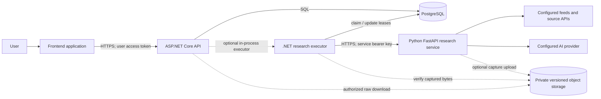

# OrionSearch: Project, Architecture and Infrastructure Guide

**Audience:** developers, project managers, QA engineers, and operators joining the project.

**Document date:** 2 November 2026.

**Scope:** the code in this repository's `feature/ai-research-report` branch and the last recorded hosting checks. Infrastructure configuration and live status can change independently of this document.

## 1. What OrionSearch is

OrionSearch is a research and knowledge-archiving application. A user creates an **archive** for a subject, configures research preferences, and submits research jobs. The backend stores the archive, tracks each job, sends work to a research service, and makes accepted results available to authorized users.

The wider product vision is an evolving collection of sources and evidence that can eventually support readable, citation-backed magazine-style editions. The archive is the durable product; a report or future magazine is a way to explore it. Some capabilities in that vision remain planned, as described below.

The system currently combines:

- An ASP.NET Core API for accounts, archive access, research submissions and result retrieval.
- PostgreSQL for user accounts, archive membership, jobs and accepted research data.
- A .NET research executor that claims durable work and communicates with the AI service.
- A separate Python/FastAPI research service that collects source metadata and can generate an AI-assisted report.
- Optional versioned S3-compatible object storage for captured source bytes, subject to explicit configuration and verification.
- A frontend maintained outside the scope of the backend implementation documented here. Its hosting address and exact implementation should be confirmed with its owner.

## 2. Product scope and terminology

| Term | Meaning |
| --- | --- |
| User | A person with an application account and an active authenticated session. |
| Archive | A user-accessible research workspace for a topic, with settings and a lifecycle status. |
| Archive membership | The relationship that gives a user an owner, editor or viewer role for a particular archive. |
| Research run | The public record of one submitted research request and its status. |
| Job | The internal durable work item used by the .NET executor to process a run. A job ID is not the public run ID. |
| Attempt and lease | A processing attempt and its time-limited right to complete a job. Leases help prevent a stale executor from committing results. |
| Source/document | A discovered URL and its metadata. Discovery alone does not mean its full contents were downloaded. |
| Document version | A specific captured representation of a source, identified using a content digest. |
| Finding and evidence | A stored statement and a reference to supporting source material. The current discovery/report path does not automatically create verified findings. |
| Report | Optional AI-generated text based on selected source metadata and feed summaries. It is not independently verified evidence. |

### Implemented versus planned

The repository contains accounts, archive management, research jobs, source browsing, report retrieval and the data model and read APIs for findings and captured versions. The producer can discover sources and optionally generate a report. Capture and durable object storage have implementation and configuration requirements of their own.

Recurring scheduled research, comprehensive semantic search, fully grounded automated findings, and a complete magazine publishing workflow are product goals, not capabilities established by this guide. A working endpoint or a successful health check is not proof that every feature is enabled or production-ready.

## 3. System overview



The API and executor can run in the same host when configured; the repository also has a separate .NET worker host. Do not run multiple execution modes without understanding their shared limits, leases and deployment configuration. Python is a separate service, not the owner of the application's queue or database.

### Main trust boundaries

1. The browser talks to the public .NET API over HTTPS. Browser origins must be explicitly allowed by API CORS configuration.
2. The API authenticates a user and verifies access to an archive before performing protected operations.
3. The .NET executor calls the Python service using a separate service credential. User credentials and PostgreSQL credentials are not forwarded to Python.
4. Source and AI-provider responses are untrusted input. The consumer validates the response and accepts results only through the current job lease.
5. If capture is enabled, Python writes to restricted storage and .NET validates stored bytes and access grants before exposing them.

## 4. Repository layout

| Path | Purpose |
| --- | --- |
| `services/api/src/OrionSearch.Api` | ASP.NET Core HTTP endpoints, middleware, request validation and authentication setup. |
| `services/api/src/OrionSearch.Application` | Application use cases, abstractions, archive and research rules. |
| `services/api/src/OrionSearch.Domain` | Core domain types and concepts. |
| `services/api/src/OrionSearch.Infrastructure` | PostgreSQL persistence, EF Core, Identity store, queue, HTTP client and object-storage adapters. |
| `services/api/src/OrionSearch.Worker` | Separate .NET worker host. |
| `services/api/tests` | API, domain, persistence and integration tests. Some integration tests require external local dependencies. |
| `services/research-worker` | Python research implementation, FastAPI interface and tests. |
| `packages/contracts/research/v1` | Shared versioned request/result schemas and synthetic examples. |
| `render.yaml` | Checked-in Render blueprint for API and PostgreSQL; actual Render settings can differ. |
| `services/api/docs` | Detailed API, database, Identity, storage, integration and operational documents. |

The separation keeps HTTP concerns at the edge, business decisions in the application layer, and concrete database/storage integrations in infrastructure. PostgreSQL remains the authoritative application store.

## 5. End-to-end user workflow

1. **Register or sign in.** With Native Identity enabled, a user registers using email and password. Email verification and third-party identity providers are not required by this implementation.
2. **Receive a session.** Login returns ASP.NET Core Identity bearer credentials. The frontend uses the user access token for protected API requests and handles expiration and refresh.
3. **Create an archive.** The API validates the title and research settings, associates the archive with the authenticated user, and creates its owner membership and settings together.
4. **Submit a research request.** An owner or editor calls the research-job endpoint with an optional objective. The backend snapshots the archive settings, creates durable work and returns `202 Accepted` with a public research run identifier.
5. **Process in the background.** The executor claims a database lease, calls the Python service and processes its response. The user does not wait for the research operation in the initial request.
6. **Poll and read results.** The frontend polls the run status. When completed, authorized members can view sources and, when present, the AI report, findings and permitted captured versions.
7. **Continue building the archive.** Additional runs can add new source associations and history. The same global document can be linked to multiple archives without automatically granting every archive access to every captured representation.

Not every step is guaranteed to finish immediately: execution may be disabled, the service may be asleep, an external provider can fail, or work can retry or fail. The frontend must treat queued, running, completed, failed and cancelled as distinct states.

## 6. Accounts and authorization

### Authentication

Native ASP.NET Core Identity is an explicitly configured feature. Account endpoints are mapped when `NativeIdentity:Enabled` is true. The user supplies an email address and password; the product does not send a confirmation email. Password validation, password hashing, failed-login handling and user management are implemented on the server.

Access and refresh tokens are protected using ASP.NET Core Data Protection. They should be treated as opaque credentials, not assumed to be JWTs. Identity security stamps and user state are checked as part of the session lifecycle; logout and password changes are relevant to revocation. The persisted Data Protection keys and the certificate used to protect them are operational recovery dependencies. Losing or replacing them without a recovery plan can invalidate existing sessions.

Never put user passwords, access tokens, worker credentials, database URLs with passwords or private keys into Git, logs, screenshots or support messages.

### Authorization and roles

Authentication answers who the caller is; archive authorization answers whether that user can access or change a specific archive. The backend checks persisted membership and user state instead of trusting an owner ID supplied by the client.

| Role | Typical permissions |
| --- | --- |
| Owner | Read, edit, submit research, and change archive lifecycle status, including soft-archiving. |
| Editor | Read and edit archive content/settings and submit research, subject to archive state. |
| Viewer | Read permitted archive data and results; cannot submit or edit as an editor. |

Some inaccessible resources return `404` to avoid exposing their existence. A user who is known to have insufficient permissions can receive `403`. Membership, archive lifecycle and consistency are all relevant to the decision; the roles do not imply a public member-management UI or API exists.

### Browser CORS

CORS is a browser-enforced cross-origin policy, not authentication. Production defaults contain no permitted frontend origins. Configure each trusted exact scheme, hostname and port using indexed settings such as `Cors__AllowedOrigins__0`; omit paths and trailing slashes. The frontend's real origin must be known before it can be allowlisted. The API permits configured origins to send methods and headers, but does not enable credentialed cookie CORS.

An `OPTIONS` preflight can return 204 while lacking `Access-Control-Allow-Origin`; that does not mean the origin was approved. The browser blocks a disallowed request even when the API is healthy. The 1 November change places CORS handling before request-size rejection so an allowed frontend can see a `413` response. It does not automatically authorize an unknown frontend address.

## 7. Archives and configuration

An archive has a title, optional description, lifecycle status, settings and owner membership. Research settings include optional date boundaries, languages, preferred and excluded domains, and a JSON configuration object. Inputs are validated, normalized and constrained by server rules; opaque settings cannot choose service credentials or arbitrary backend endpoints.

Creating an archive creates its owner relationship and settings transactionally. Changes to settings affect future submissions; a submitted job receives a settings snapshot so a later edit does not silently change that run's original intent.

Archive statuses include `active`, `paused` and `archived`. A `DELETE` request performs a **soft archive**, preserving research and source records; an owner can reactivate it through the appropriate update. Pausing or archiving affects dispatch and completion according to queue rules; it does not mean all historical data is erased.

Archive and source lists support pagination and filters. The `topic` filter is a literal case-insensitive metadata substring search, not a semantic embedding search. A missing publication date remains unknown: it must not be presented as the date the source was retrieved.

## 8. Research submission and durable execution

### Submission

`POST /archives/{archiveId}/research-jobs` requires an authenticated owner or editor and an eligible archive. The optional objective defaults to the archive title when omitted. The server validates input and applies admission and rate limits.

The optional `Idempotency-Key` allows a client to retry the same request safely. A matching repeat returns the existing run; incompatible reuse produces `409`. Without a key, a new submission creates a new run. A successful submission returns `202`, not a finished AI answer.

### Queue lifecycle

PostgreSQL stores both public research runs and internal jobs/attempts. The executor claims available work using transactional database locking, records attempts and a lease, and periodically maintains its ownership while processing. Lease expiry allows recovery if an executor stops. A completed or failed attempt must still own a valid lease and satisfy archive state and correlation checks before its result is committed. Late responses from a worker that lost ownership cannot simply overwrite a newer attempt.

Transient network and provider failures can be retried with bounded backoff; permanent contract or authentication errors fail rather than retrying indefinitely. Limits constrain concurrent work and submissions. A queue record persisting in PostgreSQL does not guarantee immediate processing when no executor is running.

### User-visible status

Clients poll `GET /research-jobs/{id}`. Public statuses include `queued`, `running`, `completed`, `failed` and `cancelled`; retry metadata distinguishes a queued retry from a new submission. While queued or running, the API can provide `Retry-After`. Respect backoff instead of polling continuously.

`GET /research-jobs/{id}/report` returns a report only when one exists and the caller has access. Missing and unauthorized reports can produce `404`; a run may legitimately complete without a report.

## 9. Python research service

The Python service exposes `GET /health` and the integrated, service-authenticated `POST /research`. The .NET service sends a versioned `orion.research.v1` JSON request and expects the same contract version and run identifier in the response. The shared schemas live under `packages/contracts/research/v1`.

The integration validates content type, size, shape and semantic constraints. Python authenticates the shared Bearer service key. The .NET consumer checks correlation and the returned metadata before persistence. This key is distinct from a user's access token and should be rotated in a coordinated way on both services.

The worker queries configured source adapters, filters and deduplicates discovered results, and can request an AI-generated report. Available adapters include Google News RSS, Hacker News, arXiv RSS and Hugging Face feeds; which ones are actually used depends on deployment configuration. Source and model availability can change. The documented 30 October hosted test used Hacker News after Google News returned a provider error. Do not assume this restricted configuration represents a complete internet search.

Discovery uses a bounded 90-day rolling window. Saved date and language settings are retained for compatibility; the worker instead uses AI to select English titles and available summaries. It excludes uncertain classifications, which can leave no results, and does not verify the language of full articles. Unknown publication dates and source-language metadata remain unknown. Preferred and excluded domains are applied to known metadata. `maxArticles` is limited to 1–50, with 20 as the documented default.

An optional report is generated from the selected source metadata and feed summaries. It can contain omissions or incorrect claims. It is not a substitute for captured full text, source verification, evidence-backed findings or human review; render it as untrusted text, not trusted HTML.

The integrated worker handles bounded capacity and can return `503` with retry guidance when busy or when providers are unavailable. Some synchronous upstream operations cannot be force-cancelled merely because the .NET request times out. The .NET lease and its exclusive database ownership are the safety boundary against late writes.

Prototype endpoints, when explicitly enabled, are separate and may use in-memory job state. They are not the application's durable queue and should not be treated as production research jobs.

## 10. Data storage and integrity

### PostgreSQL

The main schemas separate concerns:

| Schema | Examples of responsibility |
| --- | --- |
| `auth` | Users and archive memberships. |
| `research` | Archives, settings, runs and queries. |
| `content` | Publishers, documents, versions, archive links and chunks. |
| `knowledge` | Findings and evidence references. |
| `system` | Jobs, attempts, EF migration history and Data Protection keys. |
| `ai`, `publishing` | Reserved areas; their presence does not establish a finished publishing system. |

EF Core migrations define the database evolution; application startup does not automatically imply that every required migration has been applied. Changes must be backed up, reviewed for compatibility and applied deliberately. Constraints and transactions protect relationships such as archive membership, document/version links and evidence referencing the correct version.

Documents can be globally deduplicated by canonical identity while access remains archive-scoped. A link to a source does not by itself grant access to every stored version or raw object. Access grants bind permitted versions to the relevant archive.

### Optional object storage and captured versions

When capture is explicitly enabled and configured, the producer can fetch supported public content, upload raw bytes to a private versioned S3-compatible bucket and return an immutable version reference. The .NET side verifies the referenced bytes and digest before accepting them and records archive-specific grants. Downloads require user authorization. SHA-256 establishes byte integrity, not factual accuracy.

The project contains a Backblaze B2-compatible mode and prior local scoped-key/version tests. The hosted upload path and full recovery acceptance must be verified independently; earlier documentation has different activation dates and should not be treated as proof of the current live setting. Do not assume a discovered URL has a saved article or that all stored objects have a tested backup.

Use separate least-privilege credentials for readers and writers. Avoid public buckets and blanket expiration of referenced versions. Failed uploads can leave unreferenced objects; removing them requires the documented conservative inventory and retention procedure.

## 11. API surface

The public base address last recorded for the .NET API is [https://orionsearch-api.onrender.com](https://orionsearch-api.onrender.com). The root `/` is not a frontend page and can correctly return `404`. For connectivity, use `/health` and `/health/ready`. Endpoint availability also depends on deployed code and configuration.

| Area | Methods and paths | Purpose |
| --- | --- | --- |
| Health | `GET /health`, `GET /health/ready` | Process liveness and readiness including PostgreSQL connectivity. |
| Accounts | `POST /auth/register`, `/auth/login`, `/auth/refresh`, `/auth/logout`, `/auth/change-password`; `GET /me` | Create and manage an Identity session and profile. |
| Archives | `POST /archives`, `GET /archives`, `GET/PATCH/DELETE /archives/{id}` | Create, list, inspect, edit or soft-archive a workspace. |
| Sources | `GET /archives/{id}/sources`; `GET /archives/{archiveId}/sources/{documentId}` | List source metadata and inspect an authorized source. |
| Jobs | `POST /archives/{archiveId}/research-jobs`; `GET /research-jobs/{id}`; `GET /archives/{archiveId}/research-jobs` | Submit, poll and list research runs. |
| Reports | `GET /research-jobs/{id}/report` | Read an available report for an authorized run. |
| Findings | `GET /archives/{archiveId}/findings`; `GET /archives/{archiveId}/findings/{findingId}` | Read stored findings and evidence when available. |
| Captures | `GET /archives/{archiveId}/sources/{documentId}/versions`, `.../versions/{versionId}`, `.../versions/{versionId}/raw` | List permitted versions, inspect one and download authorized raw bytes. |

Typical response codes include `200` for successful reads/updates, `201` for creation, `202` for accepted asynchronous work, `204` for a successful operation without a body, `400` for invalid input, `401` for missing/invalid authentication, `403` for insufficient permission, `404` for unavailable or concealed resources, `409` for a state/idempotency conflict, `413` for oversized input and `429` for rate limiting. `5xx` indicates service or upstream failures; the cause must be diagnosed from safe logs, not assumed from the status alone.

Many errors use Problem Details JSON with a status, title, request instance and trace ID. Do not show raw stack traces or sensitive data to end users. Specific routes can have additional constraints and error meanings. For the detailed request/response reference in Bulgarian, see [api-reference-bg.md](services/api/docs/api-reference-bg.md); for implementation details see [api-and-backend-guide.md](services/api/docs/api-and-backend-guide.md).

## 12. Render infrastructure

The user-confirmed Render destination is the BolyarCoders account's **My Workspace**, in Frankfurt. The last recorded state is:

| Component | Recorded configuration |
| --- | --- |
| .NET API | `orionsearch-api`, public Render web service, Docker runtime, Free plan. |
| API address | [https://orionsearch-api.onrender.com](https://orionsearch-api.onrender.com). |
| Python research service | Separate Render web service, historically at [https://orionsearch-409q.onrender.com](https://orionsearch-409q.onrender.com). |
| PostgreSQL | `orionsearch-postgres`, managed PostgreSQL 18, Free plan, Frankfurt. |
| DB networking | Recorded external IP allowlist is empty; API uses private connectivity. |
| API health check | `/health/ready`. |
| API deployment branch | Render service is configured for `main` with automatic deployments off. |

On **1 November 2026**, the API was manually deployed from feature commit `e270b7b8dd1a3b933acc1f1aa4b87996ea3f5e75`; Render reported it live and `/health` and `/health/ready` returned 200. That is a historical observation, not a live check made on every reading of this document. The service's configured `main` branch and deployed feature commit are different: manually deploying the latest `main` without checking its contents can replace newer functionality. Merge/release decisions belong to the team; do not push directly to `main` as part of this guide.

The checked-in `render.yaml` is not necessarily the current runtime configuration. In particular it contains a default disabling research execution, while the documented hosted integration was enabled deliberately. Blueprint synchronization has previously been paused. Inspect the actual service, environment settings and current deploy before making operational changes; never apply a historical blueprint blindly.

### Free-plan limitations and persistence

The recorded Free PostgreSQL instance expires on **26 November 2026 at 06:35 UTC (08:35 in Sofia)**. The hosting record states that managed backups are not provided for that instance. The team needs an independent tested backup, restore plan and database replacement or upgrade before expiry; verify current provider terms and actual resource status in Render.

Free web services can sleep after inactivity. A first request may be delayed while the service starts, and an in-process background executor cannot promise prompt execution while its host is asleep. A production service-level objective requires a deliberately chosen execution model, monitoring and budget. Health checks show only limited state: API readiness demonstrates a database connection at that moment; it does not prove registration, worker integration, provider output, capture upload or recovery.

## 13. Configuration and secrets

Configuration belongs to the runtime environment and secret manager, not committed source files. Examples below are names, not actual secret values.

| Setting | Role |
| --- | --- |
| `DATABASE_URL` | PostgreSQL connection configuration; contains credentials and must remain secret. |
| `NativeIdentity__Enabled` | Enables native account functionality when the other required Identity configuration is present. |
| `Cors__AllowedOrigins__0`, `__1`, … | Exact allowed frontend origins. Obtain actual origins from the frontend owner. |
| `ResearchWorker__Enabled` | Enables configured .NET research processing. |
| `ResearchWorker__AgentBaseAddress` | Python research service origin. |
| `ResearchWorker__AgentApiKey` / `ORION_WORKER_API_KEY` | Matching server-side service credentials for .NET and Python. |
| `ResearchWorker__IncludeReport` | Requests the compatible optional report extension when supported on both sides. |
| `GEMINI_API_KEY`, `RESEARCH_SOURCES` | Python provider credentials and selected source adapters. Provider/model configuration must be checked in the deployed environment. |
| `CaptureStore__*`, `ORION_CAPTURE_*` | Separate API reader and worker writer storage configuration; only when capture is deliberately enabled. |
| `ReverseProxy__TrustRenderEdge` | Render-specific ingress trust option. Only use under the documented hosting and network assumptions. |

These are not exhaustive startup instructions. See [native-identity.md](services/api/docs/native-identity.md), [research-integration.md](services/api/docs/research-integration.md), and [capture-storage.md](services/api/docs/capture-storage.md) for required settings, compatible rollout, key rotation and validation. Never overwrite an entire environment-variable set merely to change one entry. Do not copy real secrets into a pull request or chat.

## 14. Operating and troubleshooting

1. **Identify the failing boundary.** Record the time, requested endpoint, HTTP status and trace ID. Avoid collecting passwords, bearer tokens or research content unnecessarily.
2. **Check liveness and readiness.** `/health` checks the API process. `/health/ready` includes PostgreSQL readiness. A healthy response is not an end-to-end test.
3. **For browser failures, inspect the real frontend origin and preflight.** Check whether the exact origin is configured and whether the response contains `Access-Control-Allow-Origin`. Browser `Load failed` can have causes other than CORS.
4. **For account failures, inspect safe validation and rate-limit responses.** Verify Identity is enabled and check whether the request is login or registration. Do not test using another person's password.
5. **For stuck jobs, inspect run state, worker enablement, leases, retries and capacity.** Check whether the API host is asleep and whether the Python service and providers are reachable. A Python health response alone does not prove a real research run works.
6. **For missing reports or captures, inspect feature configuration and run result.** A successful discovery can legitimately produce metadata without a report, captured article, finding or evidence.
7. **After a deployment, verify the deployed commit, service health, database readiness and an appropriate authorized workflow.** A queued deploy is not yet live. Use synthetic test data only with an explicit cleanup plan; avoid destructive tests against production.

Logs and trace IDs help correlate requests and failures, but provider exception bodies, raw documents and credentials should not be exposed. Back up and verify recovery before migrations, object-storage changes or data moves. Rollback of an application deployment does not automatically roll back database or object-storage changes.

## 15. Local development and testing

Prerequisites include the matching .NET SDK, Python dependencies and a PostgreSQL instance. Some integration tests additionally require Docker or isolated external services. Use only local/test credentials and isolated data. Check the service-specific READMEs for exact setup and migration commands.

```powershell
# From the repository root: API test suite (integration dependencies may be required).
dotnet test services/api/OrionSearch.sln

# Python tests, after creating/activating a virtual environment and installing
# services/research-worker/requirements-dev.txt:
Set-Location services/research-worker
python -m pytest tests agent/tests -q
```

The tests and deployment reports in older documents are dated evidence for the versions and environments tested then; they are not a guarantee that all tests pass today. This documentation update does not itself run the full application or modify the database.

## 16. Current limitations and next decisions

- **Frontend integration:** confirm its origin, configure exact CORS origins, and test the full browser registration/login and research workflow.
- **Operational persistence:** arrange independent backups, recovery of the Data Protection certificate and an actual restore drill; address the recorded database expiry.
- **Research quality and coverage:** verify source providers and model availability, improve coverage, and evaluate AI output. Reports are not automatically verified facts.
- **Reliability:** decide how an executor runs reliably within the team's hosting budget; define monitoring, alerts, retry behavior and service objectives.
- **Captured content:** verify the hosted producer-to-storage-to-API flow, permissions, object version retention and restore process before relying on it.
- **Product work:** recurring schedules, richer search, grounded findings and magazine publishing need their own requirements, implementation and acceptance.
- **Release management:** reconcile feature-branch deployments with reviewed releases on `main`, and review operational/security gates without assuming a feature branch is production-ready.

## 17. Further reading

- [Backend README and setup](services/api/README.md)
- [API and backend guide](services/api/docs/api-and-backend-guide.md)
- [Detailed Bulgarian API reference](services/api/docs/api-reference-bg.md)
- [Native Identity](services/api/docs/native-identity.md)
- [Database design](services/api/docs/database.md)
- [Research integration and hosted test record](services/api/docs/research-integration.md)
- [Research v1 contract](packages/contracts/research/v1/README.md)
- [Capture storage and integrity](services/api/docs/capture-storage.md)
- [Render hosting record](services/api/docs/render-hosting.md)
- [MVP acceptance and recovery](services/api/docs/mvp-acceptance.md)

Historical documents can contain earlier implementation or deployment states. Prefer the current code and dated verification records, and check live resources before making operational decisions.
