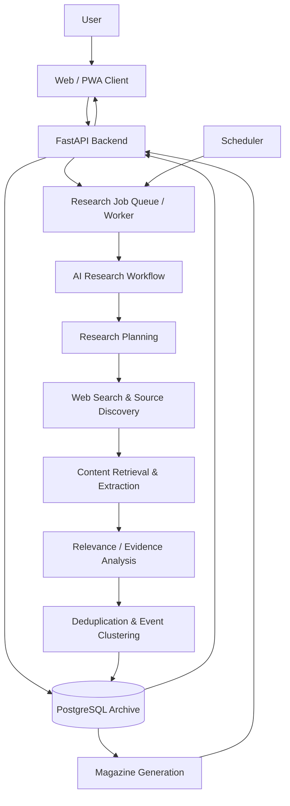

<div align="center">

# 🌌 OrionSearch

### Autonomous Research & Knowledge Archiving Platform

**Discover. Preserve. Understand.**

An AI-powered platform that continuously discovers, organizes, and preserves information about topics you care about — and turns accumulated knowledge into readable, personalized digital magazines.

**Status:** In development · Hackathon MVP

</div>

## Overview

OrionSearch is designed around a simple principle: **research should not disappear when a search session ends.**

Instead of delivering a one-off AI-generated answer, OrionSearch maintains a **persistent, self-updating knowledge archive** for every tracked topic. An autonomous research agent finds relevant public sources, extracts and structures information, identifies overlapping coverage, and updates the archive as new information becomes available.

Users can search their archives, follow developments over time, and generate magazine-style reports built from the knowledge already collected.

> **The archive is the product. The magazine is one way to explore it.**

## The Problem

Information on fast-moving topics is fragmented across news outlets, websites, reports, and other online sources. Keeping track of changes requires repeated searches, manual comparison, and substantial reading time. Traditional search engines return links; many AI research tools produce a report for a single request, but do not necessarily maintain a reusable history of what has been learned.

OrionSearch aims to bridge this gap with continuous collection, traceable evidence, historical context, and clear presentation.

## Core Capabilities

| Capability | Description |
| --- | --- |
| **Topic archives** | Create dedicated archives for topics, industries, technologies, or events. |
| **Configurable research** | Set a research topic, source preferences, date window, and update frequency. |
| **Autonomous discovery** | Search for relevant materials and retrieve accessible content from online sources. |
| **Evidence preservation** | Store source URLs, publication dates when available, retrieval timestamps, and supporting evidence. |
| **Incremental updates** | Revisit topics automatically and add newly discovered information instead of starting over. |
| **Deduplication and clustering** | Detect duplicate documents and group related coverage without discarding independent sources. |
| **Knowledge exploration** | Browse, filter, and search saved material and its history. |
| **Trend analysis** | Explore how topics, events, and coverage evolve over time. |
| **AI-generated magazines** | Generate structured, readable editions with summaries, sections, and citations. |
| **Cross-device experience** | Responsive web application first; installable PWA and additional clients are planned. |

> These are **product goals**, not a claim that every feature is already implemented.

## How It Works



### Research lifecycle

1. **Create an archive:** The user selects a topic, historical time window, preferred sources, and update schedule.
2. **Plan the research:** The agent determines search queries and subtopics based on the archive configuration.
3. **Collect sources:** Search services discover URLs; retrieval tools extract accessible documents and metadata.
4. **Analyze evidence:** The system evaluates topical relevance, identifies claims, and keeps links to their original sources.
5. **Update the archive:** Canonicalization and duplicate detection prevent redundant records; related coverage is grouped rather than silently merged.
6. **Repeat automatically:** A scheduler starts incremental research jobs according to the archive's settings.
7. **Publish on demand:** Magazine generation produces an editorial view over stored evidence, with citations back to the archive.

## Architecture

The proposed MVP follows a service-oriented design with a shared PostgreSQL store.

| Layer | Planned technology | Responsibility |
| --- | --- | --- |
| Client | **Next.js, React, TypeScript** | Archives, search, progress tracking, magazine reader |
| API | **Python, FastAPI, Pydantic** | REST endpoints, validation, orchestration, access to stored data |
| AI workflow | **LangGraph + configurable LLM** | Research planning, tool calling, analysis, synthesis |
| Data | **PostgreSQL, Alembic** | Topics, documents, findings, research history, generated editions |
| Background work | **Worker + scheduling mechanism (TBD)** | Long-running and recurring research jobs |
| Infrastructure | **Docker, Docker Compose, GitHub Actions** | Reproducible local builds, CI/CD, deployment |
| Hosting | **To be finalized** | Staging and production runtime |

**Architecture notes**

- LLM provider and web search provider should be configurable, rather than hardcoded into the business logic.
- Retrieval and analysis run in background jobs; HTTP requests should not remain open for an entire research session.
- Store normalized content and provenance separately from generated prose.
- Use idempotent jobs and database constraints to guard against repeat ingestion.
- Full-text search is the initial search option; semantic search with `pgvector` is a possible later extension.
- Trend metrics must distinguish *source coverage* from actual real-world prevalence or significance.

## Proposed Repository Layout

```text
orionsearch/
├── apps/
│   └── web/                    # Next.js application
├── services/
│   ├── api/                    # FastAPI application
│   │   ├── app/
│   │   │   ├── api/
│   │   │   ├── core/
│   │   │   ├── db/
│   │   │   ├── models/
│   │   │   └── schemas/
│   │   └── tests/
│   └── research-worker/        # Agent workflow and research tools
│       ├── agent/
│       ├── tools/
│       ├── pipelines/
│       └── tests/
├── packages/
│   └── contracts/              # Shared OpenAPI / JSON contracts
├── infra/
│   └── docker/                 # Infrastructure configuration
├── docs/                       # Product and technical documentation
├── .github/
│   └── workflows/              # CI/CD definitions
├── .env.example                # Example configuration (when implemented)
├── compose.yaml                # Local service orchestration (planned)
└── README.md
```

This is the **target structure**; paths may change as the team implements the system.

## Data Model (Planned)

| Entity | Purpose |
| --- | --- |
| `users` | User accounts and archive ownership |
| `archives` | Topic definitions, time windows, source preferences, schedules |
| `sources` | Canonical URL, title, publisher, publication/retrieval dates, content metadata |
| `archive_sources` | Many-to-many links between sources and archives |
| `research_jobs` | Job state, timing, errors, and execution metadata |
| `findings` | Extracted claims or observations, backed by source references |
| `events` / `topics` | Related event and thematic grouping (later MVP stage) |
| `magazines` | Generated editions and their source-backed content |

A single article may be relevant to more than one archive. Multiple articles may describe the same event. Both relationships should be preserved.

## API Design (Proposed)

The precise OpenAPI contract is defined during implementation. The following paths describe the intended surface:

| Method | Route | Description |
| --- | --- | --- |
| `GET` | `/health` | Service health |
| `POST` | `/archives` | Create an archive |
| `GET` | `/archives` | List archives |
| `GET` | `/archives/{archive_id}` | Get archive details |
| `PATCH` | `/archives/{archive_id}` | Update archive settings |
| `GET` | `/archives/{archive_id}/sources` | List archived sources |
| `POST` | `/archives/{archive_id}/research-jobs` | Start a research run |
| `GET` | `/research-jobs/{job_id}` | Fetch status and result metadata |
| `GET` | `/archives/{archive_id}/search` | Search archived material |
| `POST` | `/archives/{archive_id}/magazines` | Request magazine generation |
| `GET` | `/magazines/{magazine_id}` | Read a generated edition |

Example research request (illustrative):

```json
{
  "topic": "Artificial Intelligence",
  "date_from": "2026-09-01",
  "date_to": "2026-10-01",
  "languages": ["en"],
  "preferred_domains": [],
  "update_frequency": "weekly"
}
```

## Running Locally

The full development environment is **not yet confirmed as implemented**. Once the Docker setup is merged, the intended flow is:

```bash
git clone <YOUR_REPOSITORY_URL>
cd orionsearch
cp .env.example .env
# Edit .env with your own credentials and settings.
docker compose up --build
```

The commands above are a **setup target**, not tested installation instructions for the current codebase. Check the repository for `compose.yaml`, `.env.example`, and individual service documentation before running them.

Expected environment settings will include database connection information, AI model/provider credentials, a web search provider key, and job processing settings. **Never commit secrets, `.env`, API keys, or user data.**

## Reliability, Safety & Trust

Research quality and provenance are core requirements:

- **Citations:** Every substantive generated claim should reference the underlying source or stored finding.
- **Honest uncertainty:** Missing evidence, conflicting reporting, and unverifiable claims must be visible rather than silently resolved.
- **Freshness:** Track when a source was published and when it was retrieved; those timestamps are not interchangeable.
- **Source legality:** Respect site terms, robots policies where applicable, access controls, copyright, and API limits; do not bypass paywalls or authentication.
- **Data protection:** Minimize personal data, apply suitable retention and deletion controls, and evaluate GDPR obligations for user accounts and stored content.
- **Prompt injection:** Treat retrieved websites as untrusted content, never as authority to change system instructions or execute privileged operations.
- **Access control:** Keep private user archives isolated; authenticate and authorize access to archive and magazine endpoints.
- **Operational reliability:** Make jobs retryable, bounded by time/cost limits, and observable through structured logs.

## Roadmap

### Sprint 1 — MVP Foundation (12–18 October 2026)

**Goal:** Complete an end-to-end flow from creating an archive through AI research to persistent storage and a usable dashboard.

- AI service foundation, search tools, source analysis, and shared JSON schemas.
- FastAPI foundation, PostgreSQL schema, archive API, and research job integration.
- GitHub and Docker setup, staging environment, and initial CI/CD.
- Next.js app shell, archive dashboard, creation flow, and research progress UI.

**Acceptance demo:** `Create Archive → Run Research → Analyze Sources → Store Results → View Archive`

### Sprint 2 — Autonomous Archive & Publishing (19–25 October 2026)

**Goal:** Introduce incremental updates and magazine generation.

- Deduplication, event clustering, incremental research, and trend summaries.
- Scheduled background jobs, idempotent persistence, archive search, and magazine APIs.
- Worker hosting, observability, backup/recovery, and release preparation.
- Magazine reader, timeline/trend UI, archive search, and responsive PWA improvements.

**Acceptance demo:** Run research, repeat it without redundant records, ingest a newly discovered item, and generate an updated evidence-linked magazine.

Dates and scope are planning targets and may be adjusted based on hackathon constraints.

## Team & Ownership

| Team member | Responsibility |
| --- | --- |
| **Konstantin** | AI engineering — agent workflows, search, extraction, analysis, magazine generation |
| **Mert** | Backend engineering — FastAPI, PostgreSQL, APIs, job persistence |
| **Velko** | DevOps — hosting, Docker, CI/CD, deployment, monitoring |
| **Kalata** | Client applications — web UI, mobile/desktop experience, responsive design |

**Planning:** Jira project `ORION` (OrionSearch).

## Future Directions

- Personalized recurring magazine editions and subscriptions.
- Semantic retrieval and natural-language questions over archived evidence.
- Entity linking, event timelines, and knowledge graphs.
- Side-by-side comparison of reporting from multiple sources.
- Export to PDF, accessible reading modes, and audio editions.
- Dedicated mobile and desktop applications if product demand justifies them.

## Contributing

During hackathon development:

1. Work in a feature branch for each Jira issue.
2. Keep PRs focused and link the relevant `ORION-...` issue.
3. Add or update tests for changed behavior.
4. Do not merge failing CI pipelines.
5. Document new configuration fields and service dependencies.

## License

**To be decided by the team.** No open-source license is implied until a `LICENSE` file is added to the repository.

---

<div align="center">

**OrionSearch — Knowledge that grows with time.**

</div>
