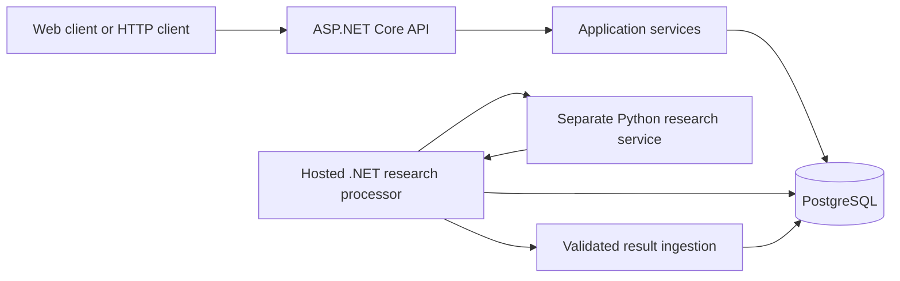
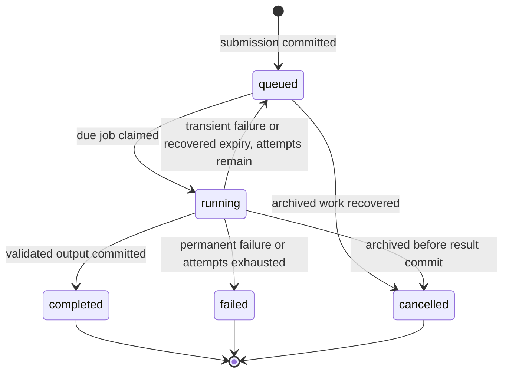

# OrionSearch API and Backend Guide

A developer reference for the HTTP API, application rules, PostgreSQL persistence and asynchronous research pipeline.

**Documentation date:** 2026-10-20. **Code snapshot:** `f08a64029b950e5ba67e5505bcae5ca811a254e7`, branch `feature/ORION-9-backend-foundation`. This guide describes the checked-out implementation. It is not a fresh audit of GitHub, Jira or deployed Railway resources.

**Subsequent implementation:** Native accounts are documented in
[Native Identity](native-identity.md), the current wire boundary in
[research integration](research-integration.md), and the P3 version listing,
normalized-text read and verified raw-download endpoints in
[capture storage](capture-storage.md). Those documents supersede the historical
foundation's missing-feature/configuration statements for their respective areas;
none of these local changes imply hosted activation.

The subsequent [Execution and results](execution-results.md) reference adds the
dedicated .NET host, history/findings/source detail reads and frontend polling
contract. It includes local Native Identity integration evidence separately from
the still-open real-provider/hosted acceptance gates.

## Contents

1. [Scope and reading notes](#scope-and-reading-notes)
2. [System overview](#system-overview)
3. [Architecture and request flow](#architecture-and-request-flow)
4. [HTTP conventions](#http-conventions)
5. [Authentication and permissions](#authentication-and-permissions)
6. [Endpoint directory](#endpoint-directory)
7. [Health and OpenAPI](#health-and-openapi)
8. [Archive endpoints](#archive-endpoints)
9. [Research job endpoints](#research-job-endpoints)
10. [Research execution internals](#research-execution-internals)
11. [Python agent boundary](#python-agent-boundary)
12. [Ingestion and provenance](#ingestion-and-provenance)
13. [Database and migrations](#database-and-migrations)
14. [Configuration reference](#configuration-reference)
15. [Local setup and operational workflow](#local-setup-and-operational-workflow)
16. [Frontend integration walkthrough](#frontend-integration-walkthrough)
17. [Errors and troubleshooting](#errors-and-troubleshooting)
18. [Tests and source map](#tests-and-source-map)
19. [Current boundaries and future work](#current-boundaries-and-future-work)

## Scope and reading notes

The implemented backend covers the work described by ORION-9 through ORION-12: the .NET HTTP foundation, PostgreSQL knowledge schema, archive management, research submission/status and background result persistence.

Read these points before trying the protected examples:

- **Normal startup authenticates nobody.** The registered authentication scheme is deliberately unconfigured. Archive and research routes return `401` until a real provider and trusted internal-user mapping are integrated. There is no login endpoint or development identity-header shortcut.
- **Research processing is disabled by default.** Accepting a queued request and executing it are separate operations. A configured, enabled worker and compatible agent are required to move work forward.
- **The Python interface is provisional.** `orion.research.provisional.v1` describes the implemented proposal, not an independently accepted final AI-team contract.
- **Examples are illustrative.** IDs, timestamps, titles, scores and counts below are synthetic. They are not records read from a deployed database. Protected success examples assume the authentication integration has been completed.
- **No database is changed by reading this guide.** Migration commands are explicit operator actions. API startup never applies migrations.

The shorter [API README](../README.md) is the setup/acceptance reference. [Database documentation](database.md) explains schema decisions in more depth. The guide below focuses on how the pieces behave together.

The [release-blocker register](release-readiness.md) records the separate CI, real authentication, producer, integration/security and deployment gates. This API guide explains the implemented foundation; it is not release approval.

## System overview

An archive is a user's research workspace. It has a title, description, lifecycle state, research settings and persisted members. Sources are global documents associated with one or more archives. Captured versions preserve the material behind those documents. Findings refer to those versions and, optionally, exact chunks.

A research run records one logical request to research an archive. A separate queue job makes that request executable and tracks retries. Attempts record individual executions. Keeping these identities separate lets a single public run survive an interrupted worker or a temporary agent failure.



The Python service performs research and returns structured output. The .NET backend authorizes requests, owns queue state, validates output and writes the knowledge database. The frontend does not submit arbitrary findings or choose internal database identities through this API.

### Important vocabulary

| Term | Meaning |
| --- | --- |
| Archive | Research workspace and access boundary |
| Membership | A persisted user/archive relationship with owner, editor or viewer role |
| Document/source | Globally identified HTTP(S) resource, deduplicated by canonical URL |
| Archive-document link | Archive-specific association, added time and relevance for a document |
| Version | A retained text/raw representation identified within its document by a content hash |
| Chunk | Addressable excerpt belonging to one version |
| Finding | A research statement, stored with its producing run where known |
| Evidence | A relationship from a finding to a captured version and optional matching chunk |
| Run | Public logical research session returned by the research API |
| Job | Internal executable queue item for a run |
| Attempt | One leased execution of a job |
| Lease | Time-bounded worker ownership before transactional completion takes exclusive ownership |

## Architecture and request flow

### Project responsibilities

| Project | Owns | Dependencies |
| --- | --- | --- |
| `OrionSearch.Api` | HTTP routes, request DTOs, authentication boundary, middleware and startup | Application and Infrastructure |
| `OrionSearch.Application` | Archive/research use cases, authorization rules, contracts and validation | Domain |
| `OrionSearch.Domain` | Entities, content fingerprints, URL/domain normalization | No ASP.NET Core, EF Core or Npgsql dependency |
| `OrionSearch.Infrastructure` | EF mappings, migrations, database stores, queue, agent HTTP client and hosted processing | Application and its Domain dependency |

Infrastructure implements application interfaces such as `IArchiveStore`, `IResearchStore`, `IResearchQueue` and `IResearchAgentClient`. API startup composes the implementations through dependency injection. HTTP contracts are separate from EF entities, so returning an archive does not serialize its persistence object or user credentials.

### HTTP request pipeline

`Program.cs` installs middleware in this order:

1. Trusted forwarded-header handling.
2. Exception handling and ProblemDetails.
3. Status-code pages.
4. CORS.
5. Authentication.
6. Authorization.
7. Endpoint execution; OpenAPI is mapped only in Development.

For a protected archive operation, the endpoint invokes `ArchiveService`. The service requires an authenticated internal user, checks that the persisted user is active, and checks archive membership when the operation targets an archive. The store executes PostgreSQL queries and projects only the response fields.

EF contexts used by HTTP services are scoped to the request. Queue operations create fresh contexts for their own transactions. The processor can therefore renew a lease without sharing a context with an external HTTP call or a result-completion transaction.

### Transaction boundaries

| Operation | Transactional unit |
| --- | --- |
| Create archive | Archive, settings and matching owner membership |
| Patch archive | Metadata/status and supplied settings changes |
| Soft archive | Archive lifecycle change |
| Submit research | Run and queue job, including idempotency lookup under the archive lock |
| Claim job | Lease, attempt generation, attempt history and running state |
| Complete research | All result writes, statistics and run/attempt/job finalization |
| Recover abandoned work | One selected job's recovery and attempt/run updates |

No database transaction remains open while the Python research service is doing external work.

## HTTP conventions

### Addresses, identifiers and JSON

The checked-in local launch profile uses `http://localhost:5190`. Paths have no `/api` or public API-version prefix. The provisional agent contract version is independent of the public HTTP route paths.

- JSON request/response examples use camelCase.
- Send `Content-Type: application/json` for POST and PATCH bodies.
- POST research accepts `{}`; an absent HTTP body is not the documented default-object request.
- Route identifiers are UUIDs. Routes use `:guid` constraints; malformed route IDs do not match the route.
- Archive settings and publication filters use `YYYY-MM-DD` dates.
- Timestamp responses represent UTC instants, normally shown with `Z` in examples.
- Nullable publication dates mean unknown. The backend does not substitute a retrieval timestamp.
- Public archive/research write DTOs reject unknown JSON properties. Do not send `ownerId`, `userId`, worker IDs or EF navigation properties.

String-length limits use .NET string length (UTF-16 code units). Chunk offsets are a separate rule and use Unicode scalar values, as explained in the agent section. Neither should be interpreted as UTF-8 byte offsets; config/metadata byte limits explicitly use UTF-8 instead.

Binding errors, unsupported methods or media types can produce framework errors in addition to the use-case errors listed for an endpoint. For example, send a JSON body/media type before interpreting a POST response as an authentication or application-validation result.

### Pagination envelope

Archive and source lists return:

```json
{
  "items": [],
  "pageNumber": 1,
  "pageSize": 20,
  "totalCount": 0
}
```

`page` is one-based, defaults to `1`, and allows `1` through `1000000`. `pageSize` defaults to `20` and allows `1` through `100`. `totalCount` counts the caller-visible rows after filtering, before paging. A page beyond the available results has an empty `items` array, while `totalCount` still describes the filtered result set. These are offset-based lists, not cursor pagination or a cross-request snapshot.

### Common error format

Application errors use `application/problem+json`. A representative field-validation response is:

```json
{
  "title": "Topic must contain 1–200 characters after trimming, without control characters.",
  "status": 400,
  "instance": "/archives",
  "traceId": "example-trace-id",
  "errors": {
    "topic": [
      "Topic must contain 1–200 characters after trimming, without control characters."
    ]
  }
}
```

ProblemDetails may also contain framework-provided fields such as `type`. The example shows the fields relevant to application handling, not a promise that these are the only members. Some binding/status errors have no field-level `errors` member.

Unexpected exceptions return a generic `500` title, `An unexpected error occurred.`, without an exception detail body. Use the trace ID to correlate a failure with server logs. Database readiness has its own plain-text response rather than this JSON envelope.

## Authentication and permissions

### Current authentication behavior

The `Unconfigured` scheme authenticates nobody in both Development and Production. `Authorization: Bearer <token>` in an example means a token from a future integrated provider; a random string cannot authenticate the current application.

The production code does not trust `X-User-Id` or `X-Test-Identity`. The latter is consumed only by a handler inside the test assembly. This handler is never registered by normal API startup.

The intended trusted flow is:

1. A configured provider validates its credentials/token according to the chosen provider's trust rules.
2. Server-side identity mapping resolves the verified external subject to an existing `auth.users.id`.
3. The resulting authenticated identity receives exactly one valid `orionsearch:user_id` UUID claim.
4. `TrustedCurrentUser` reads that internal claim.
5. Application authorization verifies an active persisted user and the persisted archive role.

Missing, malformed, empty or ambiguous internal claims fail closed. Role claims supplied by a principal do not override database membership. User creation and external-subject mapping are not performed automatically by archive requests.

### Permissions matrix

The member columns below assume an authenticated, active persisted user and consistent ownership/settings records.

| Operation | Owner | Editor | Viewer | Authenticated nonmember |
| --- | --- | --- | --- | --- |
| Create a new archive | Yes, as its new owner | Yes, as its new owner | Yes, as its new owner | Yes, as its new owner |
| List archives | Own memberships only | Own memberships only | Own memberships only | Only archives they belong to |
| Read archive or sources | Yes | Yes | Yes | `404` |
| Patch metadata/settings | Yes | Yes | `403` | `404` |
| Supply any `status` in PATCH | Yes | `403` | `403` | `404` |
| Soft archive | Yes | `403` | `403` | `404` |
| Submit research | Yes, active archive | Yes, active archive | `403` | `404` |
| Read research status | Yes | Yes | Yes | `404` |

Roles are archive-specific. A user can own one archive and view another. Creation requires an active identity, not membership of an existing archive.

Unknown/disabled application users receive `401`. Unknown archives and nonmember access both return `404`. Inconsistent owner/member records or missing archive settings can return `409`. These distinctions prevent a caller from using a direct request to enumerate someone else's archive.

## Endpoint directory

There are eight protected business operations and three public diagnostic/documentation operations in this snapshot.

| Method | Path | Access | Main response |
| --- | --- | --- | --- |
| GET | `/health` | Anonymous | `200`, process liveness JSON |
| GET | `/health/ready` | Anonymous | `200` or `503`, plain-text database connectivity |
| GET | `/openapi/v1.json` | Anonymous, Development only | `200` OpenAPI JSON; absent outside Development |
| POST | `/archives` | Active application user | `201`, archive details and Location |
| GET | `/archives` | Active application user | `200`, page of membership-scoped summaries |
| GET | `/archives/{id}` | Archive member | `200`, archive details/settings |
| PATCH | `/archives/{id}` | Owner/editor, status owner-only | `200`, resulting archive details |
| DELETE | `/archives/{id}` | Owner | `204`, soft archive |
| GET | `/archives/{id}/sources` | Archive member | `200`, page of source summaries |
| POST | `/archives/{archiveId}/research-jobs` | Owner/editor of active archive | `202`, queued/existing research run |
| GET | `/research-jobs/{id}` | Member of the run's archive | `200`, safe research status |

The examples below describe successful protected operations after provider integration. In normal unconfigured startup, the protected operations reject requests.

## Health and OpenAPI

### GET /health

Checks that the HTTP application is alive. It does not connect to PostgreSQL or the agent.

```http
GET /health HTTP/1.1
Host: localhost:5190
Accept: application/json
```

```json
{
  "status": "healthy"
}
```

Expected status: `200`. This can succeed while database readiness is unhealthy.

### GET /health/ready

The readiness check asks EF/Npgsql whether a PostgreSQL connection can be established, with a configured health-check timeout of five seconds.

```http
GET /health/ready HTTP/1.1
Host: localhost:5190
```

| Condition | Status | Plain-text body |
| --- | --- | --- |
| Database connection succeeds | `200` | `Healthy` |
| Database unconfigured/unavailable | `503` | `Unhealthy` |

This is not a schema-version check. A reachable empty database can pass connectivity readiness even though archive tables are absent. Inspect migration history separately. Readiness does not migrate or seed anything and does not verify the Python agent.

### GET /openapi/v1.json

Returns the generated OpenAPI document in Development. Outside Development the route is not mapped and normally returns `404`. There is no Swagger UI route in this implementation.

Protected operation descriptions explain the unconfigured authentication boundary. The OpenAPI document exposes contracts and response metadata, not a configured identity provider or a live integration guarantee.

## Archive endpoints

### Shared archive response

Create, retrieve and patch return `ArchiveDetails`, with two top-level objects:

```json
{
  "archive": {
    "id": "11111111-1111-4111-8111-111111111111",
    "title": "Artificial Intelligence",
    "description": "Research and developments in modern AI.",
    "status": "active",
    "role": "owner",
    "createdAt": "2026-10-20T08:00:00Z",
    "updatedAt": "2026-10-20T08:00:00Z",
    "sourceCount": 0
  },
  "settings": {
    "dateFrom": "2026-01-01",
    "dateTo": null,
    "languages": ["en", "bg"],
    "preferredDomains": [],
    "excludedDomains": [],
    "config": {},
    "updatedAt": "2026-10-20T08:00:00Z"
  }
}
```

| Archive field | Meaning |
| --- | --- |
| `id` | Archive UUID |
| `title`, `description` | Stored metadata; description may be null |
| `status` | `active`, `paused` or `archived` |
| `role` | This caller's persisted role in this archive |
| `createdAt`, `updatedAt` | UTC persistence timestamps |
| `sourceCount` | Number of archive-document links, including discovered documents without versions |

### POST /archives

Creates a new archive, settings row and owner membership together. Ownership comes from the trusted caller identity.

```http
POST /archives HTTP/1.1
Host: localhost:5190
Content-Type: application/json
Authorization: Bearer <provider-issued-token>

{
  "title": "Artificial Intelligence",
  "description": "Research and developments in modern AI.",
  "settings": {
    "dateFrom": "2026-01-01",
    "dateTo": null,
    "languages": ["en", "bg"],
    "preferredDomains": ["example.com"],
    "excludedDomains": [],
    "config": {}
  }
}
```

Successful response: `201 Created`, the shared archive response, and `Location: /archives/{newId}`. Initial status is active, role is owner, and source count is zero. Title is not a global uniqueness key; repeated POSTs create separate archives. This endpoint has no idempotency-key feature.

The minimum useful request is:

```json
{
  "title": "Artificial Intelligence"
}
```

Omitted settings default to null date boundaries, empty arrays and `{}` config. Explicit `settings: null` is invalid.

#### Creation and settings validation

| Field | Rules |
| --- | --- |
| `title` | Required, nonblank, trimmed, at most 200 characters after trimming |
| `description` | Optional/null allowed; at most 10000 characters; not automatically trimmed |
| `dateFrom`, `dateTo` | Optional/null dates; if both exist, from must be on or before to |
| `languages` | Array of at most 100 ISO 639-1 codes recognized by .NET neutral cultures; normalized by trim/lowercase |
| `preferredDomains`, `excludedDomains` | Arrays of at most 100 valid DNS domains; normalized through DNS/IDNA rules |
| Arrays | Null entries, null arrays and duplicates after normalization are rejected |
| Domain overlap | A domain cannot occur in both preferred and excluded lists |
| `config` | JSON object, at most 16384 UTF-8 bytes; omitted defaults to `{}`; null/array invalid |

Domain values are domains, not URLs. `EXAMPLE.COM.` normalizes to `example.com`; `https://example.com`, ports and paths are invalid. Config is an opaque preferences object. Saving it does not execute research or change server worker options.

Use-case errors include `400` for invalid input and `401` for an invalid/unavailable application identity. A persistence failure returns a generic server error and rolls back child/parent creation together.

### GET /archives

Lists summaries for the caller's valid persisted memberships.

```http
GET /archives?topic=artificial%20intelligence&status=active&page=1&pageSize=20 HTTP/1.1
Host: localhost:5190
Authorization: Bearer <provider-issued-token>
```

| Query parameter | Default | Behavior |
| --- | --- | --- |
| `page` | `1` | One-based page, maximum 1000000 |
| `pageSize` | `20` | Maximum 100 |
| `topic` | Omitted | Literal case-insensitive substring in title OR description |
| `status` | Omitted | Exact `active`, `paused` or `archived` |
| `includeArchived` | `false` | Include archived rows when status is omitted |

An explicit status wins over the archived default: `status=archived` returns matching archived rows without requiring `includeArchived=true`. If status is supplied, including archived does not widen that exact status filter. With neither parameter, active and paused rows remain visible and archived rows are hidden.

Ordering is `createdAt DESC, id ASC`. Membership filtering, topic/status filtering and count queries run in PostgreSQL before paging. The API does not retrieve all archives into memory to search them.

```json
{
  "items": [
    {
      "id": "11111111-1111-4111-8111-111111111111",
      "title": "Artificial Intelligence",
      "description": "Research and developments in modern AI.",
      "status": "active",
      "role": "owner",
      "createdAt": "2026-10-20T08:00:00Z",
      "updatedAt": "2026-10-20T08:00:00Z",
      "sourceCount": 2
    }
  ],
  "pageNumber": 1,
  "pageSize": 20,
  "totalCount": 1
}
```

#### Topic semantics on both list routes

The input is trimmed, then must contain 1–200 characters with no control characters. Omit it for no topic restriction. `topic=`, whitespace-only input, a 201-character normalized term or an embedded control character is invalid.

The store uses parameterized `ILIKE` predicates with an explicit escape character. `%`, `_`, `!` and backslash are literal search characters. `topic=%25` looks for an actual percent sign; it does not mean match everything. A SQL-looking string is data, not executable query text.

This is substring search over metadata. It does not classify topics, search captured document bodies, use embeddings, or split a phrase into independent words. Other filters combine with topic using AND. Null descriptions do not match on their own; a matching title still qualifies.

### GET /archives/{id}

Returns the shared archive response for an owner, editor or viewer. Archived archives remain readable by members.

```http
GET /archives/11111111-1111-4111-8111-111111111111 HTTP/1.1
Host: localhost:5190
Authorization: Bearer <provider-issued-token>
```

Expected success: `200`. Relevant application failures: `401`, `404`, and `409` for inconsistent ownership or missing settings. The response does not expose the owner's user ID, email or password hash.

### PATCH /archives/{id}

Partially updates archive metadata and/or settings. This is a JSON object with presence-aware fields, not an RFC JSON Patch operation array.

```http
PATCH /archives/11111111-1111-4111-8111-111111111111 HTTP/1.1
Host: localhost:5190
Content-Type: application/json
Authorization: Bearer <provider-issued-token>

{
  "description": null,
  "settings": {
    "dateTo": "2026-10-20",
    "languages": ["en"],
    "config": {"focus": "research publications"}
  }
}
```

Expected success: `200`, returning the resulting shared archive response. Editors/owners can change metadata/settings. Only owners may supply `status`, even if the supplied value equals the current state.

| Input form | Meaning |
| --- | --- |
| Omitted property | Retain its current value |
| `description: null` | Clear description |
| `dateFrom: null` or `dateTo: null` | Clear that date boundary |
| Supplied array | Replace the complete array |
| `config: {}` | Replace config with an empty object |
| Supplied config object | Replace the entire config; nested properties are not merged |
| `title`, `status`, `settings`, arrays or config set to null | Invalid |
| Empty `{}` | Authorized owner/editor no-op |

The full resulting settings are validated. For example, changing only `dateFrom` can still fail because it would exceed a previously stored `dateTo`. Adding an excluded domain can fail if the retained preferred-domain list already contains it.

The archive row is locked before settings are read, so concurrent patches merge against serialized committed state. Metadata and settings save in one transaction. There is no ETag/If-Match contract here; do not assume optimistic HTTP concurrency support.

An owner can pause or restore an archive with:

```json
{
  "status": "paused"
}
```

```json
{
  "status": "active"
}
```

Metadata/settings editing itself does not dispatch research. Relevant failures: `400`, `401`, `403`, `404`, `409` and generic persistence errors.

### DELETE /archives/{id}

Owner-only soft archive. Success returns `204 No Content` with no response body.

```http
DELETE /archives/11111111-1111-4111-8111-111111111111 HTTP/1.1
Host: localhost:5190
Authorization: Bearer <provider-issued-token>
```

The operation sets status to `archived`. It retains settings, memberships, research runs, jobs, links, global documents, versions, chunks, findings and evidence. Repeating DELETE is safe. Unarchive through owner PATCH with `status: active`.

Soft archiving changes whether new research can start and whether later output can commit. It is not an HTTP request that synchronously deletes work or erases captured evidence. Relevant failures: `401`, `403`, `404`, `409`.

### GET /archives/{id}/sources

Returns documents linked to an authorized archive, with publisher and archive-link metadata.

```http
GET /archives/11111111-1111-4111-8111-111111111111/sources?topic=climate&publishedFrom=2026-01-01&publishedTo=2026-10-20&language=en&publisherDomain=example.com&sort=published_desc&page=1&pageSize=20 HTTP/1.1
Host: localhost:5190
Authorization: Bearer <provider-issued-token>
```

| Query parameter | Behavior |
| --- | --- |
| `page`, `pageSize` | Standard pagination bounds/defaults |
| `topic` | Same validation/literal matching as archive topic; matches document title only |
| `publishedFrom` | Inclusive UTC publication-date lower boundary |
| `publishedTo` | Inclusive UTC publication-date upper boundary |
| `language` | Normalized recognized two-letter language code |
| `publisherDomain` | Normalized exact DNS domain match |
| `sort` | One of the six values below; default `added_desc` |

| Sort | Ordering before UUID tie-breaker |
| --- | --- |
| `added_desc` | Most recently associated with the archive first |
| `added_asc` | Oldest archive association first |
| `published_desc` | Latest known publication first, unknown last |
| `published_asc` | Earliest known publication first, unknown last |
| `relevance_desc` | Highest non-null relevance first, null last |
| `title_asc` | Database title ordering ascending, null last |

Document UUID ascending breaks ties for every sort. Publisher matching is exact after normalization, not automatic subdomain matching. Title ordering follows database behavior; it is not the same operation as case-insensitive topic matching.

Date filters use actual publication timestamps. `publishedTo=2026-10-20` includes that entire UTC day. Unknown publication dates are excluded when either boundary is supplied. No fetched/first-seen timestamp substitutes for publication. With no date filter, undated discoveries can appear.

```json
{
  "items": [
    {
      "documentId": "33333333-3333-4333-8333-333333333333",
      "canonicalUrl": "https://example.com/climate-report",
      "title": "Climate research report",
      "publisherName": "Example Publisher",
      "publisherDomain": "example.com",
      "language": "en",
      "publishedAt": "2026-10-19T12:00:00Z",
      "firstSeenAt": "2026-10-20T08:02:00Z",
      "lastSeenAt": "2026-10-20T08:02:00Z",
      "relevanceScore": 0.86,
      "addedAt": "2026-10-20T08:02:00Z"
    }
  ],
  "pageNumber": 1,
  "pageSize": 20,
  "totalCount": 1
}
```

Title, publisher, language, publication time and relevance may be null where unknown. A URL-only discovered document can appear without any captured version. A global document can be shared across archives, but only links in the requested authorized archive are returned.

The projection omits extracted text, raw storage references, version bodies and evidence. There is no public raw-download endpoint in this route set. Relevant errors include `400` for invalid dates/sorts/filters, plus `401`, `404`, and `409` from access validation.

## Research job endpoints

### POST /archives/{archiveId}/research-jobs

Authorizes and queues a logical run. Owners/editors can submit against an active archive; viewers cannot start research.

```http
POST /archives/11111111-1111-4111-8111-111111111111/research-jobs HTTP/1.1
Host: localhost:5190
Content-Type: application/json
Authorization: Bearer <provider-issued-token>
Idempotency-Key: ai-update-2026-10-20

{
  "objective": "Research recent developments in artificial intelligence"
}
```

The body has only one supported field:

| Field | Rules |
| --- | --- |
| `objective` | Optional/null uses archive title; supplied text must be nonblank and at most 2000 characters before trimming |

Use `{}` to request the default objective. The backend snapshots archive title, description and settings when the run is created. Editing the archive later does not rewrite that submitted snapshot.

Successful response: `202 Accepted`, `Location: /research-jobs/{runId}`, and a status object:

```json
{
  "id": "22222222-2222-4222-8222-222222222222",
  "archiveId": "11111111-1111-4111-8111-111111111111",
  "status": "queued",
  "createdAt": "2026-10-20T08:01:00Z",
  "startedAt": null,
  "finishedAt": null,
  "statistics": {
    "queries": 0,
    "sources": 0,
    "versions": 0,
    "findings": 0
  },
  "attempts": 0,
  "maxAttempts": 3,
  "nextAttemptAt": "2026-10-20T08:01:00Z",
  "retrying": false,
  "error": null
}
```

The public `id` is `research.research_runs.id`. It is not the private `system.jobs.id`. Save the returned run ID or Location instead of constructing a status URL from another identifier.

The API commits the run and its `research_plan` job together before acknowledging acceptance. If that transaction fails, there is no successfully accepted half-run. The HTTP request does not wait for the agent, and `202` does not promise immediate execution. Disabled/unconfigured processing leaves valid submissions queued.

Application errors: `400` invalid body/key, `401` invalid identity, `403` viewer, `404` inaccessible archive, and `409` lifecycle/idempotency/integrity conflict.

### Idempotency rules

`Idempotency-Key` is optional. When supplied:

1. It must be a single header with 1–200 visible ASCII characters (`!` through `~`), without spaces/control characters.
2. Its stored SHA-256 namespace includes the archive ID. The same client key can be used independently in different archives.
3. Submission locks the archive and compares a fingerprint of normalized client objective input.
4. A matching retry returns the original run with `202`, rather than inserting another job.
5. A different objective with the same archive/key returns `409`.

An omitted/null objective fingerprints the default-request intent, not the title text later substituted into the agent request. If the archive title changes, retrying that same default request still retrieves its original run. An explicit objective equal to a title is a different client input from an omitted objective. A replay can return an existing completed, failed or cancelled run; reusing a key does not restart it.

Existing matching submissions can be retrieved after the archive becomes paused/archived. Current identity and submission-role checks still apply. That lookup does not create new work. Without a key, each accepted POST creates a new logical run.

### GET /research-jobs/{id}

Returns safe persisted status for an owner, editor or viewer of the run's archive.

```http
GET /research-jobs/22222222-2222-4222-8222-222222222222 HTTP/1.1
Host: localhost:5190
Authorization: Bearer <provider-issued-token>
```

Example completed response:

```json
{
  "id": "22222222-2222-4222-8222-222222222222",
  "archiveId": "11111111-1111-4111-8111-111111111111",
  "status": "completed",
  "createdAt": "2026-10-20T08:01:00Z",
  "startedAt": "2026-10-20T08:01:02Z",
  "finishedAt": "2026-10-20T08:02:00Z",
  "statistics": {
    "queries": 3,
    "sources": 5,
    "versions": 4,
    "findings": 2
  },
  "attempts": 1,
  "maxAttempts": 3,
  "nextAttemptAt": null,
  "retrying": false,
  "error": null
}
```

| Field | Interpretation |
| --- | --- |
| `status` | Logical run state, listed below |
| `startedAt` | First start time; may remain populated across retries |
| `finishedAt` | Terminal completion/failure/cancellation time; null while awaiting retry |
| `statistics` | Counts recorded with committed successful output; not streaming progress |
| `attempts` | Number of claims consumed so far |
| `maxAttempts` | Job attempt limit snapshotted at submission |
| `nextAttemptAt` | Queue run-after time while the job is pending, otherwise null |
| `retrying` | Run is queued and at least one attempt has already been consumed |
| `error` | Known sanitized failure summary, or null |

`nextAttemptAt` is eligibility time, not a guaranteed execution appointment. Paused archives, unavailable workers and other queue work can delay execution further.

Statistics count the successful result's queries, sources, sources carrying captures and findings. A `versions` count is therefore not necessarily the number of new globally unique rows inserted: an accepted capture may reuse an existing version. An archive's total source count and a run's result source count answer different questions.

The endpoint excludes job payloads, worker IDs, attempt-generation tokens, service credentials and private agent configuration. Nonmembers and unknown run IDs return `404`; invalid identity returns `401`. There is no public list-all-runs, progress-stream, retry or cancel endpoint in this snapshot.

## Research execution internals

### Three linked state machines

| Object | Main states |
| --- | --- |
| Public research run | `queued`, `running`, `completed`, `failed`, `cancelled` |
| Internal queue job | `pending`, `processing`, `completed`, `failed`, `cancelled` |
| Individual attempt | `running`, `completed`, `failed`, `timed_out` |

The run is queued while its job is pending. A claim moves the run to running and the job to processing. A retry returns the run/job to queued/pending, retaining attempt history. A terminal result closes the current attempt and run/job together.



The diagram summarizes worker-driven behavior. It does not expose state-changing HTTP endpoints beyond submission and archive lifecycle updates.

### End-to-end execution sequence

```mermaid
sequenceDiagram
    participant C as Client
    participant A as API
    participant D as PostgreSQL
    participant W as .NET processor
    participant P as Python agent
    C->>A: POST archive research request
    A->>D: Authorize, lock archive, insert run and job
    D-->>A: Commit
    A-->>C: 202 and public run ID
    W->>D: Recover abandoned work; claim due job
    D-->>W: Committed lease and attempt generation
    W->>D: Recheck ownership and archive before dispatch
    W->>P: Versioned authenticated research request
    Note over W,P: Heartbeats renew the lease during external work
    P-->>W: Structured result
    W->>W: Stop and await heartbeat task
    W->>D: Lock job, validate live ownership, lock archive
    W->>D: Ingest output and finalize states atomically
    D-->>W: Commit
    C->>A: GET research status
    A->>D: Authorized status projection
    A-->>C: completed and committed counts
```

### Claiming and scheduling

The hosted service starts processing only when enabled and configured. Its process instance gets a random worker ID. It drains available work serially within that hosted loop, then polls again when idle. Multiple running instances can compete safely; this is not an in-process memory queue.

Claims select `research_plan` jobs that are pending, due according to PostgreSQL wall-clock time, below their attempt limit, attached to a queued run and active archive. Selection uses priority descending, then creation time and job UUID, with `FOR UPDATE OF j SKIP LOCKED`.

SKIP LOCKED lets another worker choose a different job instead of blocking on a row already claimed or completed by someone else. The claim transaction also locks/rechecks the archive, increments attempts, creates a running attempt, records worker ID/lease deadline and commits running state before external HTTP work.

This worker does not execute every job type permitted by the broader queue schema. It currently claims the `research_plan` use case only. There is no recurring scheduler creating periodic submissions.

### Leases, heartbeats and fencing

The worker's lease includes job ID, run ID, archive ID, worker ID and attempt generation. Heartbeats renew only the current unexpired processing lease. A different attempt generation, worker or terminal state cannot renew it.

Completion first normalizes/validates output, then starts its persistence transaction. `OwnedAsync` acquires the job-row lock and checks ownership with fresh database time after lock acquisition. This second expiry check matters: a SELECT predicate could have been evaluated before waiting for another transaction's unchanged row lock.

Once valid ownership has been acquired, the completion transaction retains its exclusive job lock. Ingestion may cross the original lease deadline without invalidating that already-owned transaction. Finalization still checks IDs, processing status, worker and attempt generation, but does not expire itself simply because time passed while holding the lock.

This does not permit stale workers to return later and acquire ownership. An actually expired worker that has not already acquired valid completion ownership is rejected. Concurrent recovery uses row locking/SKIP LOCKED and cannot steal the job from a completion transaction holding its row lock.

The processor stops and awaits its heartbeat task before entering either completion or failure finalization. An in-flight renewal settles before the completion transaction takes the job row. This prevents renewal and finalization from racing against each other in the same attempt.

### Retry and failure policy

| Failure category | Typical trigger | Retry while attempts remain? |
| --- | --- | --- |
| Timeout | Agent request/body timeout or abandoned expired attempt | Yes |
| Unavailable | Network/interrupted body, agent 408/429/5xx | Yes |
| Paused | Archive paused after claim and before dispatch | Yes |
| Authentication | Agent 401/403 or missing usable agent authentication in a direct call | No |
| Contract | Unsupported version, invalid JSON/result, invalid references or other permanent protocol failure | No |
| Persistence | Unexpected result-persistence failure | No |
| Archived | Archive archived before dispatch/completion | No; cancel |

Backoff is exponential and capped:

```text
delay = min(RetryMaxSeconds, RetryBaseSeconds × 2^(attempt - 1))
```

With defaults, successive delays would be 10, 20, 40, 80, 160, 300 seconds and then remain capped. The default maximum of three attempts normally prevents reaching that entire sequence. Attempts are not reset by requeueing, so transient failures cannot retry forever.

A failed attempt and a retried logical run are different: the attempt closes with failed/timed-out state while the public run returns to queued. Do not show a queued retry as terminal merely because its safe `error` field describes the previous attempt.

### Archive lifecycle during research

| Archive state/change | Effect |
| --- | --- |
| Active | New submissions and due claims permitted |
| Paused before submission | New work rejected with `409` |
| Paused with pending work | Pending work waits for reactivation |
| Paused between claim and dispatch | Attempt consumes a claim and is requeued with bounded backoff |
| Paused after dispatch | Already dispatched work may finish |
| Archived before new submission | New work rejected with `409` |
| Archived pending work | Cancelled when recovery processes it |
| Archived during external work | Late result cannot commit after observing archived state |

Completion and archive lifecycle updates serialize through the archive row lock. If completion commits first, the results exist before a later soft archive. If archiving wins first, completion observes the archived state and does not persist late results. This is transaction ordering, not a promise that an already committed result can be undone.

### Shutdown, recovery and atomicity

Host cancellation stops external work and leaves an unfinished lease available for later recovery. A crash before commit rolls back result writes and releases locks. Expired processing jobs are closed as timed out and requeued if eligible, or failed/cancelled when appropriate. Recovery also handles exhausted or archived pending work, in bounded batches of up to 100 per call.

Worker operations lock job before archive. Global ingestion writes use deterministic publisher/domain and document/URL ordering. Archive HTTP operations do not acquire existing job rows. This lock order helps avoid cycles between lifecycle edits and queue completion.

If final worker/generation fencing fails, the whole ingestion transaction rolls back. Terminal replay cannot insert the same attempt's findings a second time. This is not a general guarantee that two intentionally different submitted runs cannot produce similar findings; idempotency and terminal replay have specific boundaries.

## Python agent boundary

### Transport and version

`HttpResearchAgentClient` sends a POST to `research` relative to the configured `AgentBaseAddress`. For example, `https://agent.example/internal/` becomes `https://agent.example/internal/research`.

The service request uses JSON and `Authorization: Bearer <configured-service-credential>`. This is backend-to-agent authentication, separate from the frontend identity provider. Agent endpoints are server configuration, never client archive fields.

Agent addresses require HTTP(S), no embedded user credentials, query or fragment, and HTTPS except for loopback or `.railway.internal` hosts. Redirects are disabled. The client bounds total call/body time and reads the response with a byte limit, including when Content-Length is absent.

The implemented version is `orion.research.provisional.v1`. There is no automatic negotiation or fallback to another version. Both sides must explicitly agree a version; the response must echo the correct version and backend-issued run ID. Unknown result fields and missing required constructor fields are rejected.

### Backend-issued request

```json
{
  "contractVersion": "orion.research.provisional.v1",
  "researchRunId": "22222222-2222-4222-8222-222222222222",
  "archiveId": "11111111-1111-4111-8111-111111111111",
  "title": "Artificial Intelligence",
  "description": "Research and developments in modern AI.",
  "objective": "Research recent developments in artificial intelligence",
  "settings": {
    "dateFrom": "2026-01-01",
    "dateTo": null,
    "languages": ["en"],
    "preferredDomains": [],
    "excludedDomains": [],
    "config": {},
    "updatedAt": "2026-10-20T08:00:00Z"
  }
}
```

The archive topic is the `title` field; there is no additional `topic` member in this agent request. Public source-list query parameters are not the agent request schema. The request contains no queue job ID, attempt ownership token, database credential or client-selected internal user identity.

### Representative successful result

```json
{
  "contractVersion": "orion.research.provisional.v1",
  "researchRunId": "22222222-2222-4222-8222-222222222222",
  "queries": [
    {"query": "research methods", "provider": "example-search"}
  ],
  "sources": [
    {
      "key": "source-1",
      "canonicalUrl": "https://example.com/source",
      "title": "Research source",
      "language": "en",
      "publishedAt": null,
      "publisher": {"name": "Example Publisher", "domain": "example.com"},
      "relevance": 0.8,
      "capture": {
        "fetchedAt": "2026-10-20T08:02:00Z",
        "extractedText": "Research preserves evidence.",
        "raw": null,
        "chunks": [
          {"index": 0, "text": "Research preserves evidence.", "startOffset": 0, "endOffset": 28, "tokenCount": null}
        ],
        "metadata": {"producer": "example-agent"}
      }
    }
  ],
  "findings": [
    {
      "key": "finding-1",
      "statement": "The source describes evidence preservation.",
      "type": "observation",
      "confidence": 0.8,
      "evidence": [
        {"sourceKey": "source-1", "stance": "supports", "chunkIndex": 0, "quote": "preserves evidence"}
      ]
    }
  ]
}
```

The source and finding keys are response-local labels. They are not UUIDs and cannot point to arbitrary existing database records. Backend ingestion resolves real identities after inserting/upserting the accepted output.

The authoritative proposal shapes and independent examples are [request schema](../../../packages/contracts/research/provisional-v1/request.schema.json), [result schema](../../../packages/contracts/research/provisional-v1/result.schema.json), [request fixture](../../../packages/contracts/research/provisional-v1/request.json) and [result fixture](../../../packages/contracts/research/provisional-v1/result.json). Cross-reference and exact-text rules additionally run in C#; JSON shape validation alone is insufficient.

### Important validation limits

| Area | Current limit or rule |
| --- | --- |
| Queries/sources/findings | Each array has at most 256 entries |
| Source/finding keys | Nonblank, at most 80 ASCII letters/digits/dot/underscore/hyphen; unique in their array |
| Query/provider | Nonblank, maximum 2000/200 characters; normalized query/provider pairs must be unique |
| Source URL | Maximum 4096 characters and valid canonicalizable HTTP(S) URL; normalized URLs unique within output |
| Source title | Optional, nonblank when present, maximum 2000 characters |
| Publisher | Actual nonblank name/domain, maximum 200/253 characters; domain normalized |
| Dates | Supplied publication dates use UTC; fetch time UTC and no earlier than Unix epoch |
| Captured text | Nonblank when present; maximum 1000000 characters before normalization |
| Raw capture | Durable absolute https/s3/gs/urn URI, maximum 4096 characters, without user-info; 64-character lowercase SHA-256 |
| Capture metadata | JSON object when supplied, maximum 16384 UTF-8 bytes |
| Chunks | At most 256 per capture; unique nonnegative indices; text maximum 100000 characters |
| Findings | Nonblank statement, maximum 10000 characters; type claim/observation/estimate |
| Evidence | At most 100 per finding; valid source and optional valid chunk reference; no duplicate evidence entries |
| Quotes | Nonblank when present, maximum 10000 characters, exact substring of referenced text/chunk |
| Scores | Nullable relevance/confidence, otherwise between 0 and 1 |
| HTTP body | Default 2 MiB response cap, configurable within worker limits |

Omitting capture is allowed for a discovery. Supplying a capture requires retained text, raw metadata or both. Raw-only evidence can refer to a version without a text quote, but cannot assert a quote/chunk that the backend cannot verify from retained text.

Chunk offsets count **Unicode scalar values** in normalized extracted text, not UTF-8 bytes or JavaScript UTF-16 code units. Start is inclusive; end exclusive. Both offsets must be supplied together or both absent. With offsets, the selected substring must exactly equal chunk text; without them, chunk text must still be an exact substring.

### Failed agent calls

A non-success response is a failure, not an alternate success-result schema. For example, a `503` with `{"error":"temporarily_unavailable"}` is classified as unavailable. The error body is ignored and never returned to API callers. Agent 401/403 become authentication failures; 408/429/5xx are transient; other non-2xx statuses are permanent contract failures. Invalid/missing/oversized JSON results cannot become successful persistence.

Agree the final ORION-8 contract, real producer, service credential, durable capture storage and deterministic chunking strategy before enabling a live integration. The fixture tests demonstrate backend contract handling, not actual LangGraph execution.

## Ingestion and provenance

### What is persisted on success

Inside the owned completion transaction, `ResearchIngestion` performs this work:

1. Normalize and upsert publishers by domain.
2. Upsert documents by canonical URL, retaining existing known title/language/publisher/publication data and advancing last-seen time.
3. Insert/update each archive-document association and its supplied relevance.
4. For captures, find/create the document version by document ID and chosen content hash.
5. Enrich missing retained text/raw references without replacing original version identity or first capture metadata.
6. Derive backend-owned representation metadata.
7. Insert/reuse chunks and reject conflicting definitions at an existing chunk index.
8. Insert research queries and findings with run provenance.
9. Resolve evidence source/chunk labels to actual database identities.
10. Finalize run statistics, attempt and job, then commit everything together.

If a required write or final fence fails, the transaction does not expose partially accepted results. The agent does not independently write these tables.

### URL identity and global deduplication

Canonical URL normalization lowercases scheme/host, converts international hostnames to ASCII, removes default ports and fragments, and ensures an empty path becomes `/`. It preserves path case, meaningful trailing slashes, encoded path bytes and query order/parameters. HTTP and HTTPS remain different identities.

For example, `HTTPS://EXAMPLE.COM:443/source#section` becomes `https://example.com/source`. The normalizer rejects credentials, whitespace/control characters, backslashes, malformed percent escapes and non-HTTP(S) source URLs. It does not fetch redirects or interpret publisher canonical tags, and it does not automatically strip tracking parameters.

Global uniqueness means two archives can reuse one `content.documents` row and its versions. Each archive still has its own association. Sharing a document identity does not grant one archive's members access to another archive's metadata, run or membership.

### Discovery versus captured version

| Agent source | Database effect |
| --- | --- |
| URL/metadata without capture | Document and archive link; no invented version |
| Text-only capture | Version identified by normalized-text SHA-256 |
| Raw-only capture | Version identified by supplied raw-byte SHA-256 and retained storage reference |
| Text plus raw capture | Version identity uses normalized-text hash; raw digest recorded independently |

A fetch failure or discovery is not a reason to fabricate empty extracted text, a hash of the URL or a placeholder raw reference. Empty captured bytes have a real raw-byte hash, but absence of captured material is a different state.

### Hashing and enrichment

Text hashing uses this exact order:

```text
Unicode NFC → normalize line endings to LF → trim outer whitespace
→ encode UTF-8 → SHA-256 → lowercase hexadecimal
```

Internal text whitespace is preserved. Raw hashing applies SHA-256 directly to the exact stored bytes without decoding or normalization.

Versions are unique by `(document_id, content_hash)`. The original hash basis is preserved in `metadata.content_hash`. Adding a representation does not retroactively relabel that original identity.

| Situation | Result |
| --- | --- |
| Same document and same chosen digest | Reuse version; preserve ID and first fetch timestamp |
| Text version later gains raw storage | Preserve text identity; retain raw URI and its own raw digest |
| Raw-only version later gains text with equal digest | Reuse raw-identified version; keep original raw identity basis/reference and add text provenance |
| Raw and text digests differ in separate raw-only/text-only captures | Separate versions under the same global document |
| Existing raw reference has no known digest | Keep digest unknown; never borrow a text digest |
| Existing chunk index has different text/offsets | Reject that output and roll back its transaction |

Incoming agent metadata cannot authoritatively set `content_hash`, `raw_sha256` or `representations`. The backend derives those values from accepted representations while preserving previously stored identity/producer provenance.

The stored representation object describes retained text and raw material independently. Text records algorithm, normalized-text digest and `nfc_lf_trim_v1`; raw records retained storage URI and a known digest/algorithm when available. The flat `raw_sha256` remains a compatibility alias for a known retained raw digest. Legacy metadata without enough information is not rewritten into invented certainty.

The backend validates raw-reference/digest shape. It does not currently fetch an external object to prove its existence or recompute its bytes. Durable storage and external object-integrity verification are separate integration work.

### Findings and evidence

Findings are stored as `unverified` even if the model supplies confidence or supporting evidence. Confidence is metadata, not proof of truth or a calibrated probability.

Every evidence record must reference a retained document version. A chunk reference is optional. When present, a composite foreign key ensures the chunk belongs to that same version. A finding's evidence cannot cite an arbitrary database UUID supplied by the agent: all references resolve through accepted response-local source/chunk labels.

Quoted text is checked against the referenced normalized text/chunk. This verifies exact textual correspondence; it does not establish that the source is correct or that the model's interpretation is sound. There is no public findings/evidence listing endpoint in this snapshot, even though those records are persisted.

## Database and migrations

### Seven schemas and fifteen product tables

| Schema | Table | Responsibility |
| --- | --- | --- |
| `auth` | `users` | Persisted application identity, status and optional password hash |
| `auth` | `archive_members` | Composite user/archive membership and role |
| `research` | `archives` | Owner, topic metadata, state and timestamps |
| `research` | `archive_settings` | One-to-one date/language/domain/config preferences |
| `research` | `research_runs` | Logical research lifecycle, safe statistics/error storage |
| `research` | `research_queries` | Queries/provider history for a run |
| `content` | `publishers` | Globally normalized publisher domains |
| `content` | `documents` | Canonical URL identity and source metadata |
| `content` | `document_versions` | Captured representation, hash, fetch time and provenance |
| `content` | `archive_documents` | Archive/document association and relevance |
| `content` | `document_chunks` | Indexed version excerpts and optional offsets/token count |
| `knowledge` | `findings` | Statements, type/confidence/status and optional producing run |
| `knowledge` | `finding_evidence` | Finding/version/optional matching chunk relationships |
| `system` | `jobs` | Executable queue state, payload, lease, retry time and idempotency |
| `system` | `job_attempts` | Per-generation execution history |

`ai` and `publishing` are reserved schemas with no product tables yet. `system.__ef_migrations_history` is EF infrastructure and is not part of the fifteen-table product count.

### Database guarantees versus application rules

PostgreSQL enforces foreign keys, valid state/role/type values, uniqueness, nonblank capture requirements, score bounds, chunk bounds and hash format. Examples include unique email through citext, unique canonical URL, unique version hash per document, unique chunk index per version, and unique research-plan job per non-null run.

Some invariants require both layers. The partial unique owner-membership index permits at most one owner row, but cannot require that row to exist and match `archives.owner_id`. The application creates the matching owner/settings records atomically and rejects inconsistent direct access. Database CHECK constraints restrict values but do not independently implement every queue transition or authorize a caller.

Explicit timestamps use UTC `timestamptz`. Created/discovery/fetch defaults use database transaction time. Update triggers maintain `updated_at` on the mapped mutable tables. Date-only preferences remain PostgreSQL `date` values.

Indexes support memberships, canonical lookups, versions by document/fetch time, archive research history, pending queue priority/due time, expired leases and evidence traversal. A simple-language GIN full-text index exists for chunks, but the public `topic` query does not use it or expose full-text/semantic search.

### Migration chain

| Order | Migration | Purpose |
| --- | --- | --- |
| 1 | `20261016091659_CreateUsersAndSchemas` | Schemas, citext and users |
| 2 | `20261016091721_CreateArchivesAndMembership` | Archives, settings and memberships |
| 3 | `20261016091741_CreateResearchHistory` | Runs and queries |
| 4 | `20261016091749_CreateContentStorage` | Publishers, documents, versions, links and chunks |
| 5 | `20261016091811_CreateFindingsAndEvidence` | Findings and evidence integrity |
| 6 | `20261016091819_CreateJobQueue` | Jobs, attempts and queue indexes |
| 7 | `20261016095458_AllowRawOnlyDocumentVersions` | Nullable extracted text with capture/provenance constraints |
| 8 | `20261018073825_ImplementResearchExecution` | Finding/run provenance, one plan job per run and nonblank capture checks |

Migrations are explicit deployment work; they are not called during API startup. EF model consistency can be checked without applying anything. Existing-data upgrades validate rather than silently fabricate missing capture information. Downgrade guards refuse to discard raw-only content or populated run provenance. A general Down migration can remove product data and is not a production recovery strategy.

### Read-only inspection

The existing [inspection script](../scripts/inspect-database.sql) runs a read-only transaction and reports database version, schemas, citext, tables, migration IDs, counts and constraints without returning application records.

With an already authorized connection supplied securely through libpq environment configuration, run from `services/api/`:

```sh
psql -X -v ON_ERROR_STOP=1 -f scripts/inspect-database.sql
```

Expected shape after all migrations: seven logical schemas, fifteen product tables, eight known EF history entries and citext. Reachable readiness alone cannot establish that shape. Unexpected catalog/history should be reviewed before changing a shared database.

## Configuration reference

### Configuration sources

ASP.NET Core loads base appsettings, environment appsettings, Development user secrets, environment variables and command-line arguments with later sources taking precedence. Use `__` to express nested configuration in environment variables.

`.env` and `appsettings.Local.json` are not automatically loaded. Array configuration merges by index, so supplying a shorter origin/proxy list through another source may leave higher indexed values from the earlier source.

### API settings

| Environment key | Default / purpose |
| --- | --- |
| `ASPNETCORE_ENVIRONMENT` | Production without launch profile; checked-in profile sets Development |
| `ASPNETCORE_URLS` | Local profile binds `http://localhost:5190`; explicitly set addresses without profile |
| `AllowedHosts` | `*` in checked-in settings; restrict for the intended deployment |
| `Cors__AllowedOrigins__0` | Development includes `http://localhost:3000`; base settings have no origins |
| `ReverseProxy__KnownProxies__0` | Extra trusted IPs; none configured by default |
| `ReverseProxy__TrustRenderEdge` | Explicit rate-limit client IP mode for the isolated Render Free public web service; default false |
| `Logging__LogLevel__Default` | Information; console logging uses JSON |
| `ConnectionStrings__OrionSearch` | Explicit Npgsql connection string |

CORS permits methods/headers for configured exact origins, without credentialed cookie requests. Invalid origin/proxy configuration stops startup. Forwarded headers accept only X-Forwarded-For/Proto for one hop from default loopback or configured trusted proxies. Untrusted peers cannot choose their apparent client address/scheme by supplying these headers. HTTPS redirection is not installed for local HTTP; deployment TLS belongs to the configured proxy boundary.

When the Render Free edge mode is enabled, the two IP rate limiters use only
Render's edge-provided `CF-Connecting-IP` and ignore client-controlled
`X-Forwarded-For` for partitioning. This mode depends on Render Free's lack of
private ingress and must not be used when requests can bypass the public edge;
see [render-hosting.md](render-hosting.md). Other request processing retains the
configured forwarded-header trust rules.

### Database connection resolution

Runtime and EF design-time use the same precedence:

1. `ConnectionStrings:OrionSearch` / `ConnectionStrings__OrionSearch` as an Npgsql ADO.NET string. An explicitly empty value disables lower-priority fallback.
2. `DATABASE_URL` as a PostgreSQL URI, parsed into an Npgsql connection string.
3. `PGHOST`, `PGPORT`, `PGDATABASE`, `PGUSER`, `PGPASSWORD` composed using `NpgsqlConnectionStringBuilder`; default port 5432.

`DATABASE_URL` accepts postgres/postgresql schemes, encoded credentials and the supported `sslmode` query values disable/allow/prefer/require/verify-ca/verify-full. Other URI query parameters are rejected; use an explicit Npgsql string for additional options. A URI is not an ADO.NET connection string, so do not put it directly into `ConnectionStrings__OrionSearch`.

Keep credentials in managed variables or local secret storage. For a future API service in the same Railway environment, `${{Postgres.DATABASE_URL}}` is an example Railway variable reference, not a literal value to place in a local shell. Private Railway names are intended for the same environment network; local access requires an authorized connection method. This guide neither exposes a database port nor changes TLS validation.

### Worker options

All options are under `ResearchWorker`; environment keys begin `ResearchWorker__`.

| Option | Default | Valid range / interpretation |
| --- | --- | --- |
| `Enabled` | false | Opt-in to hosted processing |
| `LeaseSeconds` | 120 | 10–3600 |
| `HeartbeatSeconds` | 30 | At least 1 and at most one third of lease duration |
| `PollSeconds` | 5 | 1–300 |
| `TimeoutSeconds` | 300 | 1–3600; agent operation including response body |
| `MaxAttempts` | 3 | 1–10; copied into newly submitted jobs |
| `RetryBaseSeconds` | 10 | 1–3600 |
| `RetryMaxSeconds` | 300 | At least base, at most 86400 |
| `MaxResponseBytes` | 2097152 | 1024–10485760 |
| `AgentBaseAddress` | Unset | Valid server-selected HTTP(S) endpoint under the address rules above |
| `AgentApiKey` | Unset | Visible ASCII bearer credential, 1–4096 characters, for configured client |
| `AllowProvisionalContract` | false | Explicit acceptance of provisional-boundary use |

An invalid options range fails startup validation, even if processing was intended to be disabled. A valid but missing agent configuration leaves the client unconfigured. When the hosted adapter is enabled but discovers an unconfigured agent, it logs and exits its processing loop; configuration/restart must be handled operationally rather than assuming the loop will dynamically adopt later credentials.

Changing default attempt limits does not rewrite existing jobs. Poll interval is a worker concern, not a prescribed frontend refresh interval. Lease timeout and HTTP timeout are separate: long external calls remain owned through renewals, and final ingestion is protected by its transaction locks.

## Local setup and operational workflow

### Start without external services

From `services/api/` with .NET SDK 10.0.204 (or an allowed patch from the configured feature band):

```sh
dotnet restore
dotnet tool restore
dotnet build
dotnet run --project src/OrionSearch.Api
```

The local launch profile selects Development. In another terminal:

```sh
curl http://localhost:5190/health
curl http://localhost:5190/health/ready
curl http://localhost:5190/openapi/v1.json
```

Liveness/OpenAPI require no database in Development. Readiness will be unhealthy until connectivity is configured. Archive/research requests still require the missing real identity integration; starting locally does not imply an authenticated demo user exists.

### Configure a local development database

Use a deliberately selected local development database and user. The following is a placeholder example, not a working credential:

```powershell
dotnet user-secrets set 'ConnectionStrings:OrionSearch' 'Host=localhost;Port=5432;Database=orionsearch_dev;Username=orion_app;Password=<local-password>' --project src/OrionSearch.Api
```

Runtime Development user-secret loading and design-time EF configuration are not identical. The context factory resolves environment variables; supply an authorized connection through environment configuration for EF commands as described in the API README. Check the selected database before applying migrations.

For example, in the terminal used for local EF tooling, replace the placeholder with that local development credential:

```powershell
$env:ConnectionStrings__OrionSearch = 'Host=localhost;Port=5432;Database=orionsearch_dev;Username=orion_app;Password=<local-password>'
```

These commands generate/review SQL or check the model:

```sh
dotnet ef migrations has-pending-model-changes --project src/OrionSearch.Infrastructure
dotnet ef migrations script --idempotent --project src/OrionSearch.Infrastructure --output reviewed-migrations.sql
```

Only after reviewing the destination and migration SQL should an operator apply the chain:

```sh
dotnet ef database update --project src/OrionSearch.Infrastructure
```

Do not commit credentials, dumps or generated review SQL as part of routine setup. Applying this command to a shared environment is a separate authorized operation, not something startup does in the background.

### Run in Production mode locally

```powershell
$env:ASPNETCORE_ENVIRONMENT = 'Production'
$env:ASPNETCORE_URLS = 'http://localhost:5191'
dotnet run --project src/OrionSearch.Api --no-launch-profile
```

Use the port selected above. OpenAPI should be absent; health remains public; archive/research endpoints remain fail-closed without real authentication. This is a local mode check, not an actual production deployment.

### Run the test suite

The normal full suite uses real PostgreSQL. With Docker running, the fixture can provision its own PostgreSQL container (default image postgres:16-alpine). Alternatively provide an explicitly local test-admin connection capable of creating/dropping disposable databases:

```powershell
$env:ORIONSEARCH_TEST_POSTGRES = 'Host=localhost;Port=5432;Database=postgres;Username=orion_test;Password=<test-password>'
dotnet test
```

**The fixture creates and drops databases named `orion_tests_<uuid>`. Never set this connection to Railway or another shared application database.** This variable is test configuration, not the API's runtime connection setting. The fixture tracks its owned databases and disposes them after execution.

For container tests, `ORIONSEARCH_TEST_POSTGRES_IMAGE` selects the test image when the direct local test connection is absent. Setting an image string is not evidence that a version actually ran.

Other local checks:

```sh
dotnet format OrionSearch.sln --verify-no-changes
dotnet ef migrations has-pending-model-changes --project src/OrionSearch.Infrastructure
```

## Frontend integration walkthrough

This sequence assumes a real provider has been integrated and the agent/worker intentionally configured when execution is needed.

1. Authenticate through the team's provider. Let server mapping determine the internal application user; do not send a user UUID as authority.
2. POST `/archives` with title and optional preferences. Save `archive.id` and Location.
3. GET `/archives` for the user's workspace list. Use `role` to decide which controls to display, while leaving final enforcement to the server.
4. GET `/archives/{id}` to display current metadata/settings. Send a sparse PATCH containing only changed fields.
5. Generate one stable idempotency key for a deliberate research action and POST its request to `/archives/{id}/research-jobs`.
6. Save the returned run ID. The response is acceptance, not completed research output.
7. Poll GET `/research-jobs/{runId}` at a reasonable client-selected interval, handling normal network/application failures. There is no SSE/WebSocket status endpoint.
8. Show queued/running states. A queued run with `retrying=true` is waiting for another attempt, not a new run that should be resubmitted automatically.
9. On completed status, refresh `/archives/{id}/sources` and archive summaries. Use `totalCount` for the current filtered list, not the run's source statistics.
10. On failed/cancelled status, display the sanitized error and stop treating that run as active. Starting a distinct run is a new explicit action; replaying the old key retrieves the old run.

### Client handling by response

| Response | Useful client behavior |
| --- | --- |
| `201` | Save the newly created archive ID |
| `202` | Save/reuse the run ID and follow status; do not assume success |
| `204` | Stop expecting a JSON response body and refresh lifecycle visibility |
| `400` | Show field errors where available and correct request input |
| `401` | Resolve authentication/provider/user mapping; do not retry with a caller ID header |
| `403` | Respect the persisted-role restriction |
| `404` | Treat resource as unavailable to the caller; do not reveal whether another user owns it |
| `409` | Inspect idempotency/lifecycle/integrity explanation; do not blindly replay changed content |
| `500` | Surface a generic failure and retain trace ID for investigation |
| Readiness `503` | Operational connectivity failure, distinct from a research run's safe error field |

Preserve null publication dates rather than showing them as today. Keep query-filter state separate from the archive's persisted research date preferences: `publishedFrom/publishedTo` filter stored sources, while settings `dateFrom/dateTo` become future research preferences.

## Errors and troubleshooting

| Symptom | Likely explanation / next check |
| --- | --- |
| Every archive request returns 401 | Expected with unconfigured authentication; validate real provider/internal-user mapping |
| A bearer string or X-User-Id does nothing | These are not an authentication implementation |
| Health works but readiness fails | Application alive; inspect configured connection and database availability |
| Readiness works but archive operations fail | Connectivity does not verify tables/migrations; inspect catalog/history separately |
| OpenAPI returns 404 | Check environment; it is mapped only in Development |
| Research stays queued | Worker disabled/unconfigured, archive paused, future due time, or other queued work |
| No work resumes after supplying agent credentials | Enabled hosted loop can exit when agent is unconfigured; inspect logs and planned restart/configuration |
| Research repeatedly returns queued with retrying true | Transient attempts are being retried with backoff; inspect safe error and attempts |
| Same idempotency key returns 409 | Client objective differs from the original normalized request |
| Replaying key returns a completed/failed run | Expected: replay retrieves; it does not restart |
| PATCH fails despite changing one field | Validation checks retained and supplied settings together |
| Editor cannot PATCH status | Lifecycle changes are owner-only, including unchanged supplied status |
| Archived archive vanished from list | Default list hides archived rows; use explicit status/includeArchived when appropriate |
| Date filter hides a known source | Its publication date may be unknown or outside UTC boundaries |
| Topic percent sign does not match all rows | Wildcards are escaped; it is literal substring matching |
| Agent result rejected although JSON parses | Version, references, UTC dates, hashes, exact quotes/chunks and limits also require semantic validation |
| Source visible without text | Discovery can create document/link without a version; source endpoint is metadata-only |
| Two versions exist for raw and text captures | Different chosen hashes legitimately identify separate versions |
| A raw object cannot be downloaded from this API | Raw storage/reference resolution is not exposed by current source routes |
| Tests cannot start PostgreSQL | Start Docker or provide an isolated local test-admin connection |

Public research errors use a finite safe vocabulary: service timed out, temporarily unavailable, authentication misconfigured, invalid result, archive paused before dispatch, archived/cancelled, results could not be stored, or a generic sanitized fallback for unknown stored errors. They do not contain the agent's private failure body or database exception.

## Tests and source map

### Test responsibilities

| Suite | Behavior pinned |
| --- | --- |
| Api/Configuration/ReverseProxy/Readiness tests | Startup, ProblemDetails, environment restrictions, CORS/proxy trust and health |
| ArchiveAuthentication/ArchiveOpenApi tests | Default rejection, trusted identity rules and exposed contract metadata |
| ArchiveApi/ArchiveSource/ArchiveTopic tests | Atomic CRUD, membership, lifecycle, SQL filters, dates, counts, ordering and isolation |
| Persistence tests | Actual PostgreSQL constraints, relationships, schema/catalog, indexes, upgrades and data preservation |
| ResearchApi/ResearchCommit tests | Authorization, snapshots, idempotency and acceptance after commit |
| ResearchQueue/ResearchCompletion tests | Claims, leases, contention, expiry, post-lock ownership, final fencing, recovery and rollback |
| ResearchProcessing/ResearchLifecycle tests | Processing outside HTTP, failure policy, disabled/unconfigured behavior and shutdown/lifecycle |
| ResearchOutput/ResearchAgentHttp tests | Fixture semantics, wire contract, malformed bodies, response limits and sanitized transport failures |
| ResearchVersionProvenance tests | Raw/text enrichment, equal/different hashes, legacy unknowns and retained evidence identity |

The earlier handoff recorded 348 passing tests on PostgreSQL 18.6 and a 22-case concurrency repeat. Those are historical handoff results, not a claim that the full suite was rerun while writing this document. The checks performed for this documentation change should be reported separately.

### Where to look in source

All links below are relative to this guide.

| Concern | Source |
| --- | --- |
| Pipeline and mapped route groups | [Program.cs](../src/OrionSearch.Api/Program.cs) |
| Authentication/CORS/proxy/errors/OpenAPI registration | [ServiceCollectionExtensions.cs](../src/OrionSearch.Api/Extensions/ServiceCollectionExtensions.cs) |
| Trusted identity and unconfigured scheme | [TrustedCurrentUser.cs](../src/OrionSearch.Api/Authentication/TrustedCurrentUser.cs) |
| Archive route contracts | [ArchiveEndpoints.cs](../src/OrionSearch.Api/Endpoints/ArchiveEndpoints.cs), [ArchiveRequests.cs](../src/OrionSearch.Api/Archives/ArchiveRequests.cs) |
| Archive use cases/validation | [ArchiveService.cs](../src/OrionSearch.Application/Archives/ArchiveService.cs), [ArchiveValidation.cs](../src/OrionSearch.Application/Archives/ArchiveValidation.cs) |
| Membership/ownership checks | [ArchiveAuthorization.cs](../src/OrionSearch.Application/Archives/ArchiveAuthorization.cs) |
| Archive/source SQL projection and filters | [EfArchiveStore.cs](../src/OrionSearch.Infrastructure/Archives/EfArchiveStore.cs) |
| Research HTTP routes | [ResearchEndpoints.cs](../src/OrionSearch.Api/Endpoints/ResearchEndpoints.cs) |
| Research submission/idempotency | [ResearchService.cs](../src/OrionSearch.Application/Research/ResearchService.cs) |
| Public status, queue interface and worker options | [ResearchContracts.cs](../src/OrionSearch.Application/Research/ResearchContracts.cs) |
| Agent DTOs, version and safe failure categories | [AgentContracts.cs](../src/OrionSearch.Application/Research/AgentContracts.cs) |
| Status projection | [EfResearchStore.cs](../src/OrionSearch.Infrastructure/Research/EfResearchStore.cs) |
| Claims/ownership/finalization/recovery | [EfResearchQueue.cs](../src/OrionSearch.Infrastructure/Research/EfResearchQueue.cs) |
| Hosted loop and heartbeat coordination | [ResearchProcessor.cs](../src/OrionSearch.Infrastructure/Research/ResearchProcessor.cs) |
| Agent transport | [HttpResearchAgentClient.cs](../src/OrionSearch.Infrastructure/Research/HttpResearchAgentClient.cs) |
| Semantic result validation | [ResearchOutputValidator.cs](../src/OrionSearch.Application/Research/ResearchOutputValidator.cs) |
| Transactional upserts and provenance | [ResearchIngestion.cs](../src/OrionSearch.Infrastructure/Research/ResearchIngestion.cs) |
| Content hashing and URL identity | [ContentFingerprint.cs](../src/OrionSearch.Domain/Content/ContentFingerprint.cs), [CanonicalUrl.cs](../src/OrionSearch.Domain/Content/CanonicalUrl.cs) |
| Database model and migration directory | [OrionSearchDbContext.cs](../src/OrionSearch.Infrastructure/Persistence/OrionSearchDbContext.cs), [Migrations](../src/OrionSearch.Infrastructure/Persistence/Migrations) |
| Design-time environment resolution | [OrionSearchDbContextFactory.cs](../src/OrionSearch.Infrastructure/Persistence/OrionSearchDbContextFactory.cs) |
| Connection parsing and readiness | [PostgresConnection.cs](../src/OrionSearch.Infrastructure/Persistence/PostgresConnection.cs), [DatabaseReadinessCheck.cs](../src/OrionSearch.Infrastructure/Persistence/DatabaseReadinessCheck.cs) |
| Example HTTP requests | [OrionSearch.Api.http](../src/OrionSearch.Api/OrionSearch.Api.http) |
| Tests | [OrionSearch.Tests](../tests/OrionSearch.Tests) |

## Current boundaries and future work

The checked-out implementation provides archive management and the backend half of a research pipeline. It does not provide public endpoints for login/registration, managing memberships, listing/downloading versions, reading findings, cancelling/retrying/listing all runs, recurring scheduling, magazines, embeddings or semantic search.

The .NET worker is currently a hosted service composed into the API application, while the Python research service is separate. Moving the processor into a dedicated .NET host is possible through its interfaces but is not a deployment already implemented here.

Before claiming a complete live product flow, the team must integrate a real identity provider and provisioning/mapping, agree the research contract, deploy the compatible Python producer, select/verify durable capture storage, configure intended API/worker deployment and execute an authenticated end-to-end run against the authorized environment. CI/deployment and Railway operational readiness are separate from passing local backend tests.

These boundaries explain why an API can start successfully, a database can be reachable, and contract fixtures can pass while real protected frontend access or LangGraph execution still requires integration work.
