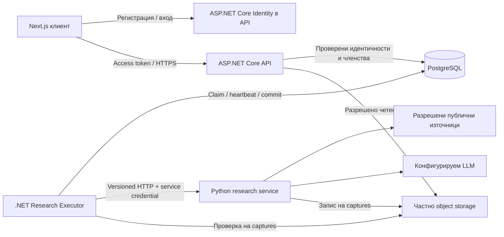

# OrionSearch: архитектурен план за завършване на бекенда

Дата: 28 октомври 2026 г. Статус: предложение за изпълнение, не доказателство за готовност.
Основа за прегледа: локален commit `e70c2e077f45c2b2ad6f0cf0743c0ed60874f76f`.

Решения на собственика от 28 октомври: само ASP.NET Core Identity, без third-party identity provider; регистрация само с имейл и парола, без писма за потвърждение. Входът е достъпен веднага след регистрация. Няма SMTP зависимост или email recovery в първия пакет.

Текущ branch: `feature/backend-integration`. P1 е реализиран в `549085a`.
P2 вече има съвместими .NET/Python v1 реализации, общи fixtures и проверена
локална HTTP връзка; виж [research integration](research-integration.md).
Това адресира несъвместимостите от изходната снимка по-долу. P3 остава следващият
пакет: реални captures, устойчиво съхранение и проверка на доказателствата.
Външно одобрение на договора, real-provider и hosted acceptance не се подразбират.

## 1. Цел и граници

Първата използваема версия трябва да позволява на реален потребител да влезе, да създаде архив, да стартира проучване и да прочете съхранени резултати с проследими източници. Данните и задачите трябва да преживяват рестарт. Друг потребител не трябва да получава достъп до тях без членство.

Това е MVP. Пълният продуктов обхват добавя периодично проучване, търсене в съдържанието и списания с цитати. Не блокираме MVP с embeddings, нов message broker, Kubernetes или смяна на AI framework. LangGraph може да остане вътрешен избор на AI екипа; HTTP договорът не трябва да зависи от него.

Планът не разрешава платени ресурси, промени в production данни, merge или push към main. Не добавя CI/CD. Съществуващите проверки се запазват; пускането остава ръчно.

## 2. Проверена изходна точка

| Област | Налична реализация | Липса |
| --- | --- | --- |
| API | ASP.NET Core, ArchiveEndpoints, ResearchEndpoints, ProblemDetails, CORS и proxy конфигурация | Native Identity implementation/acceptance и допълнителни четящи endpoints |
| Данни | EF Core, осем миграции, 15 продуктови таблици | Външни идентичности, потребителски резултати/търсене, publishing и scheduling разширения |
| Авторизация | Активен вътрешен потребител и persisted owner/editor/viewer членства | Реален начин за получаване на доверен вътрешен потребител |
| Изпълнение | PostgreSQL опашка, leases, heartbeat, bounded retries, fencing и атомарно ingestion | Приет договор и реален съвместим агент; включен hosted worker |
| Python | FastAPI и research прототип | Съвместим request/result, durable capture, единна отговорност за задачите |
| Хостинг | Документиран успешен Render deploy от 27 октомври | Постоянно съхранение, worker hosting и оперативно приемане |

Конкретно несъответствие: .NET изпраща versioned request с `Authorization: Bearer`, а Python очаква `topic/days/max_articles` и `X-API-Key`. Резултатът на Python също не съвпада с provisional result schema. Само задаване на URL няма да свърже услугите.

Това е проверка на код и документи. Live услугите, текущите GitHub проверки, тарифите и актуалните Jira статуси не са проверявани отново за този план. Старият release register съдържа исторически Railway/PR данни; следва да бъде актуализиран с доказателства при изпълнението, а не приеман за текуща инвентаризация.

## 3. Целева архитектура

API и executor използват един Application/Infrastructure код. За локална демонстрация executor може да работи в API процеса чрез наличния BackgroundService. За постоянно работещ продукт предпочитаме отделен .NET Worker host, който използва съществуващия ResearchProcessor, без да копира queue логиката. Двата режима са изрични настройки на deployment-а.

### Собственост и зависимости

| Данни/поведение | Единствен собственик | Другите компоненти |
| --- | --- | --- |
| Credentials и смяна на парола | ASP.NET Core Identity / PostgreSQL | Identity хешира паролите; няма plaintext пароли или външен IdP |
| Вътрешни потребители и security stamps | auth.users чрез Identity UserManager и EF store | Frontend не избира user ID или роли |
| Архиви, членства, изследвания, jobs и attempts | .NET application services / PostgreSQL | Python няма database credentials |
| Съдържание, версии, evidence и крайни резултати | .NET ingestion / PostgreSQL | Agent връща недоверен резултат по договор |
| Запазени сурови bytes | Object storage | PostgreSQL държи object key, digest, размер и provenance |
| AI planning, retrieval, synthesis | Python service | Не управлява публичното състояние на задачата |
| UI състояние | Frontend | Производно от API; не е durable store |

Domain не зависи от EF/HTTP/identity SDK. Application дефинира use cases и интерфейси; Infrastructure реализира persistence, Identity store, HTTP и object storage. API и Worker host композират зависимостите. Не създаваме нов микросървис за всеки use case.

## 4. Идентичност и акаунти

Използваме ASP.NET Core Identity с настоящия domain User и адаптер за IUserPasswordStore/IUserEmailStore/IUserSecurityStampStore/IUserLockoutStore. Така запазваме auth.users, съществуващите UUID и archive foreign keys, без framework dependency в Domain и без втори credential store. UserManager/SignInManager управляват паролите и правилата; не пишем собствен password hasher или token codec.

1. Регистрация само с email и password; displayName се извежда от локалната част на имейла. Unique citext email и normalized email са DB backstop срещу конкурентни регистрации. Съществуващ акаунт не се свързва или презаписва от нова регистрация.
2. Вход веднага след регистрация. Не се изпращат писма и не се изисква потвърждение. Имейлът не се третира като доказателство за собственост на пощенската кутия, покана или recovery credential.
3. Вход с Identity password verification, lockout след пет неуспешни опита и общ отговор при отказ. Начална парола: 12–128 символа и стандартните Identity composition rules.
4. Вградени opaque Identity bearer tokens: 15 минути access, 7 дни refresh. Това не са JWT; не са нужни issuer/audience. Access/refresh имат отделни protection purposes и не са взаимозаменяеми.
5. Data Protection keys се пазят в system.data_protection_keys. Production изисква PFX сертификат за криптиране и същия сертификат при рестарт/restore. Непълна включена конфигурация отказва startup. Изключеният foundation режим не предоставя auth endpoints и отхвърля защитени заявки.
6. При всяка защитена заявка се проверяват active status и security stamp. Logout от всички устройства и смяна на парола отнемат съществуващите сесии. Refresh също проверява stamp и account state. Вградените refresh tokens не са еднократни; replay остава възможен до expiry/revocation и е изрично ограничение за MVP.
7. Членствата в archive_members остават авторитетът за достъп. Публичната регистрация не приема user ID, статус или роли. Потребителите без парола не получават автоматично нова самоличност чрез migration.

Нов `GET /me`: вътрешен ID, email и displayName. Auth routes и конфигурацията са описани в [Native Identity](native-identity.md). Смяна на парола изисква текущата парола и валидна сесия; възстановяване на забравена парола остава извън този пакет, докато се избере сигурно доказване на собствеността. Frontend трябва да пази bearer tokens извън persistent browser storage; за браузърна продукция предпочитаме server-side/BFF session с HttpOnly cookie, като BFF пази и обновява API tokens. Cookie режим директно в API и MFA са отделни последващи промени, които изискват CSRF/session дизайн и тестове; не ги обещаваме с първия native bearer пакет.

За MVP архивите могат да са лични с един owner. Споделянето изисква отделен дизайн с доказване на самоличността на получателя; непотвърден email не предоставя членство. Не публикуваме endpoint за произволно задаване на owner или добавяне на човек по отгатнат UUID.

## 5. Research договор и изпълнение

### Един публичен lifecycle

Запазваме `POST /archives/{id}/research-jobs` → 202 и `GET /research-jobs/{id}`. PostgreSQL притежава `queued → running → completed/failed/cancelled`; transient retry връща работата в queued с nextAttemptAt. Paused архив не dispatch-ва нова работа; archived архив не приема ново проучване и спира резултат при commit проверката. Вече приключила работа не се пренаписва от закъснял опит.

Python `/research/jobs` с in-memory речник не се използва в интегрирания поток. Първоначално запазваме синхронно вътрешно HTTP изпълнение, ограничено по време и обем. Frontend получава 202 веднага от .NET, независимо от продължителността на вътрешното HTTP извикване.

### Договор v1

Нова директория `packages/contracts/research/v1/` със schemas, fixtures, error taxonomy и producer/consumer тестове. Предложено име: `orion.research.v1`. Използваме съществуващия provisional shape като отправна точка, не като вече приет стандарт.

- Request: contractVersion, researchRunId, archiveId, title, description, objective, snapshotted settings. Точните required/optional полета се фиксират в schema.
- Result: същите contractVersion/researchRunId; queries, sources, findings; source-local keys, captures, deterministic chunks и evidence references.
- Единна service authentication: Bearer credential от secret configuration, отделен от user tokens. Ротацията допуска кратък overlap от два ключа само на приемащата страна.
- Чужда версия, run ID или невалидни references се отхвърлят. Unknown fields не се игнорират мълчаливо.
- Запазваме началните лимити на .NET: 300 s timeout, 2 MiB response, максимум 256 елемента на основните колекции и 3 attempts. Това са начални настройки, не обещан SLA; съгласуват се с реалните proxy и provider ограничения.
- 401/403 и невалиден output са permanent failure. 408/429/5xx, мрежови грешки и timeout са bounded retries. Уважаваме валиден Retry-After в рамките на общ retry budget; не наслагваме неограничени retries в Python и .NET.

Claim, heartbeat, recovery и completion остават в съществуващата queue реализация. Няма отворена DB транзакция през AI/HTTP работа. Преди commit се проверяват текущият lease, attempt generation, archive state и output invariants; ingestion и финалният status са в една транзакция.

Доставката е at-least-once. Fencing предотвратява двойно приемане, но не гарантира еднократно платено LLM извикване при timeout/crash. За MVP това е ограничено чрез attempts, concurrency и budget. Ако цената налага producer deduplication, добавяме durable execution receipt по backend-issued request fingerprint; това е кеш на изпълнението, не втори публичен job lifecycle.

Ако реалните проучвания не се побират в HTTP лимитите, отделен ADR въвежда durable agent execution handle и polling. Не добавяме паралелен in-memory job протокол като временен заместител.

## 6. Captures, доказателства и четене

Използваме частен S3-compatible storage зад интерфейс `ICaptureStore`. Конкретният provider е deployment решение след проверка на квоти, регион, lifecycle и цена. Локално тестовете използват временен bucket/съвместим store; не production bucket.

- Agent-ът пише само в определен attempt prefix с ограничени права. Връща object key, точен SHA-256 на bytes, размер, media type и fetchedAt. Не връща credentials или вечен публичен URL.
- .NET приема само allowlisted bucket/prefix, проверява размер, съществуване и digest чрез ограничен stream преди DB ingestion. Няма transaction през object I/O; резултатът се обвързва с конкретна immutable object version или content-addressed object key, така че обектът да не се подменя след проверката.
- Upload предхожда DB commit. При неуспех може да остане orphan object; cleanup премахва само нереферирани обекти след grace period и повторна проверка. Не изтрива глобално споделен capture при архивиране на един архив.
- Text normalization, Unicode scalar offsets и exact quotes запазват сегашните правила. Не наричаме feed summary пълен текст на статия. Discovery без capture не получава фиктивна версия или цитат.
- API предоставя разрешено четене или краткотраен signed URL след membership проверка. Raw bytes не се сервират като доверен HTML; задават се безопасни content headers и download поведение.

Предложени нови read endpoints:

| Endpoint | Предназначение |
| --- | --- |
| `GET /archives/{id}/research-jobs` | Пагинирана история на проучванията |
| `GET /archives/{id}/findings` | Findings с филтри и кратки evidence описания |
| `GET /archives/{id}/findings/{findingId}` | Finding и проверими references |
| `GET /archives/{id}/sources/{documentId}` | Източник и разрешени версии в контекста на архива |
| `GET /archives/{id}/sources/{documentId}/versions/{versionId}` | Разрешена captured версия и excerpts |

Пътищата са предложение, не съществуващи routes. Всяка заявка проверява membership и реалната връзка на резултата с архива. Глобално споделен document ID не е достатъчен за достъп до всички негови версии. Evidence се чете през run/archive provenance; legacy findings без run не стават автоматично публични. Ако UI трябва да показва една находка в няколко архива, въвеждаме явна archive_findings асоциация с миграция и правила, вместо да гадаем връзката от общ URL.

Няма нова агрегатна таблица за резултата на MVP: статусът, findings, sources и evidence се извеждат от съществуващите записи. Ако frontend изисква narrative report, добавяме отделен versioned report модел; не скриваме неограничен Markdown в queue payload или statistics JSON.

## 7. След MVP: търсене, scheduling и списания

### Търсене

Първо PostgreSQL full-text search над разрешени captured texts и findings, с подходящи GIN индекси, измерен query plan и pagination. `GET /archives/{id}/search?q=...` връща typed hits с evidence/version IDs и plain-text snippets. Езиковата tokenization стратегия се определя с български/английски fixtures. Съществуващият topic substring filter не се представя като full-text search.

Embeddings се добавят само след измерено качество на baseline search. Тогава модел, dimensions, model version и reindex процедура са изрична схема; vectors са възстановим индекс, а не собственик на документите.

### Периодични обновявания

Нова archive_schedules таблица: archive FK, enabled, timezone, cadence, nextRunAt, lastScheduledAt и revision. Начален UI поддържа ограничени периоди, не произволен cron текст. Scheduler-ът създава нормален run/job атомарно с уникален `(scheduleId, scheduledFor)` ключ. Няма втори тип ingestion.

При рестарт пропуснатите интервали се обединяват до едно наваксващо изпълнение; няма storm от исторически runs. Paused/archived архиви не получават нови заявки. Часовете се пазят UTC; timezone се използва за потребителския график и DST тестовете. Външен scheduler може само да събуди dispatcher чрез защитен механизъм; PostgreSQL остава авторитетът.

### Списания

Добавяме publishing.editions и edition_sections с archive, status, version, generation metadata и immutable snapshot на избраните finding/evidence/version IDs. Draft → generating → ready/failed; публикуването е отделно owner/editor действие. Нова редакция не променя старото издание.

Генерирането използва същия durable job механизъм с отделен job type/договор, лимити и retries. Всеки показан цитат трябва да сочи към разрешено съществуващо доказателство. Неподкрепено твърдение не получава измислен citation. LLM text е недоверено съдържание; Markdown/HTML се sanitizе-ва при визуализация.

Предложени routes: `POST /archives/{id}/editions`, `GET /archives/{id}/editions`, `GET /archives/{id}/editions/{editionId}`. Export/PDF и публично споделяне са отделен обхват със собствени права и retention.

## 8. Откази, сигурност и наблюдение

| Отказ | Поведение |
| --- | --- |
| DB недостъпна | Readiness 503; без false 202 и без memory fallback; ливнесът остава отделен |
| Identity отказ | Без DB/key access няма нова сесия; няма login bypass или незащитен recovery endpoint |
| Agent/LLM бавен или недостъпен | Cancel/timeout, bounded retries, safe public status; без частичен DB commit |
| Невалиден output или подменен capture | Permanent safe failure; невалидните данни не стават резултат |
| Worker crash | Lease expiry/recovery; нов attempt; stale completion се отхвърля |
| Object upload без DB commit | Нерефериран обект с ограничен retention; последващ cleanup |
| Storage недостъпен при четене | Контролиран 503 за capture; metadata може да остане достъпна |
| Quota/budget изчерпани | Отказ на ново скъпо изпълнение с ясен safe код; не се заобикаля лимит чрез retry |

Минимални мерки преди публична употреба:

- Rate limits на user и IP, отделни лимити за research submission, bounded queue depth, малка начална concurrency и дневен research/token budget. Проверки при submission и dispatch; промяна на Idempotency-Key не заобикаля бюджета.
- Само exact frontend CORS origins; проверена proxy конфигурация. Няма wildcard origins като решение за login проблем.
- Fetcher SSRF защита: само http/https, блокирани private/loopback/link-local/metadata адреси, повторна DNS/IP проверка за всяко пренасочване, лимити за размер/време/media type и защита от decompression bombs. Не приемаме browser-selected agent URL.
- Prompt injection от източници не може да сменя инструменти, credentials или политики. LLM няма DB credentials; tool allowlist и мрежовите правила се налагат от кода.
- Secrets само в environment/secret store, отделни runtime и migration роли; agent upload права не дават delete/read-all.
- Audit за членства, disablement и административни операции, без token-и, source bodies и лични данни в логовете. Окончателна retention политика преди реални потребителски данни.

Логове: traceId, researchRunId, attempt и finite error code. Метрики: най-стара queued задача, queue depth, worker heartbeat, success/failure/timeout rate, retries, durations, ingestion rejection, storage bytes и provider usage/cost. Run IDs са log fields, не high-cardinality metric labels. Readiness на API не доказва работещ worker; отделен heartbeat/queue-age сигнал показва това.

## 9. Deployment, миграции и възстановяване

За production моделът е API + .NET executor + Python service + PostgreSQL + private object storage. Това са роли, не обещание, че всички могат да бъдат хоствани постоянно безплатно. Преди избор се проверяват текущите platform ограничения и бюджет. Не използваме изкуствен keepalive като гаранция за изпълнение.

При нулев бюджет поддържаме честно ограничена демонстрация с операторски включен executor/agent и ясно показан статус на обработката. Не обещаваме 24/7 проучване или scheduler, когато няма постоянно изпълнение. За използваем hosted MVP executor и agent трябва да имат реален execution capacity.

Последният deployment record отчита Render free DB expiry на 26 ноември 2026 г. Това е запис от 27 октомври, а не нова проверка на акаунта. Преди реална употреба: потвърждаваме срока, осигуряваме export и restore test и избираме постоянна DB опция с одобрен бюджет. Не чакаме expiry за първи backup.

Миграциите се добавят след съществуващите осем; не ги редактираме. Expand → deploy compatible code → backfill where needed → enforce constraints. Старите nullable provenance записи не получават измислени run IDs. Новите job types и CHECK constraints се въвеждат преди producer-а им.

Ръчен release от main след преглед и разрешен merge. Съществуващият Render Blueprint трябва да бъде retarget-нат след merge на hosting конфигурацията; промяна само на render.yaml не променя live source. Auto deploy/sync остава off. Записват се точните API/agent/contract revisions, schema version и настройките без secrets.

Rollback връща съвместима application версия. Не изпълнява destructive Down migration. Преди рискова промяна: DB backup + object manifest и restore в изолирана среда. Начални цели за приемане: RPO до 24 часа и RTO до 4 часа, които трябва да бъдат постигнати в реален restore drill; не са текущи гаранции.

## 10. План за изпълнение и критерии за приемане

Идентификаторите P0–P7 са локални work packages, не създадени Jira tickets. Собствениците са роли за разпределение от екипа.

| Пакет | Отговорник / зависимости | Конкретна работа | Критерий за завършване |
| --- | --- | --- | --- |
| P0: решения и hosting budget | PM + backend + AI + ops | Избрани са native Identity и регистрация без потвърждение; остават сертификат, capture store, execution capacity и backup | Кратки ADR-и, проверени лимити и одобрен runtime модел; без provision преди бюджетно разрешение |
| P1: identity | Backend + frontend; след native Identity решението | Identity store, token validation, регистрация с email/password, незабавен вход, смяна на парола, GET /me, disablement | Реален login без SMTP; конкурентна регистрация дава един account; invalid/expired/revoked tokens и disabled users са отказани; restart/restore не губи keys |
| P2: contract v1 | Backend + AI; започва паралелно с P1 | Две schemas, fixtures, Bearer auth, Python adapter, точни capture/chunk/evidence правила | И двете реализации минават едни и същи valid/invalid fixtures, включително Unicode; реалният producer дава приемлив резултат |
| P3: storage и ingestion | Backend + AI + ops; след P2 shape и store решението | ICaptureStore, immutable upload references, digest verification, read authorization, orphan policy | Проверени реални bytes/digests; липсващ/подменен обект не се приема; orphan cleanup не засяга referenced capture |
| P4: execution и results API | Backend + AI + frontend; след P1–P3 | Worker host/config, лимити, read endpoints, polling UI contract | Реален user → archive → 202 → agent → completed → sources/findings; рестарт не губи jobs; stale attempt не пише; потребител B не вижда A |
| P5: MVP acceptance | Целият екип; след P4 | Security/failure tests, hosted smoke, backup/restore, runbook, release register update | Изпълнени проверки с commits/run IDs; named reviewer приема остатъчните ограничения; няма UNVERIFIED задължителна проверка |
| P6: search и schedules | Backend + frontend + ops; след MVP | Full-text search, schedule persistence/dispatcher, overlap и budget policy | Измерено търсене без cross-archive leaks; restart/DST/double-dispatch тестове; реално capacity за periodic execution |
| P7: editions | Backend + AI + frontend; след стабилни findings/evidence | Versioned publishing schema, generation jobs, citation validation, read UI | Издание с проверими разрешени цитати; стара версия остава непроменена; неподкрепен output не се публикува |

Последователност: P0 → (P1 и P2 успоредно като екипна работа) → P3 → P4 → P5 → P6/P7. Backend authorization/read DTO работата може да започне с fixtures преди live agent, но това не затваря live acceptance.

Не даваме календарен срок преди P0/P2 да изяснят schema и hosting ограниченията. Всеки пакет се разделя на малки feature PR-и; authentication, agent adapter и hosting не се смесват в един непроверим PR.

### Файлове и модули за промяна

- P1: `src/OrionSearch.Api/Authentication`, `Extensions/ServiceCollectionExtensions.cs`, нов identity use case в Application, EF entity/configuration и нова миграция в Infrastructure, нови identity/API tests.
- P2: `packages/contracts/research/v1`, `Application/Research`, `Infrastructure/Research/HttpResearchAgentClient.cs`, Python `api/models.py`, `api/security.py`, adapter около `api/service.py`, producer/consumer tests. Provisional v1 остава отделно до координирано изключване; няма тих fallback.
- P3: нови storage интерфейс/adapter и tests; `ResearchIngestion` се променя само след проектирано разделяне на I/O verification от DB commit.
- P4: `Endpoints` и Application read services; нов .NET Worker host, използващ съществуващия processor; deployment configuration с изрично включване само след приемане.
- P6/P7: нови migrations и отделни Search/Scheduling/Publishing use cases. Не поставяме целия orchestration код в Program.cs или Python route handlers.

## 11. Проверки, съвместимост и решение за пускане

Тестови граници: WebApplicationFactory за HTTP, реален изолиран PostgreSQL за persistence/leases/Identity, реалните password hasher и bearer handler, replaceable agent/storage interfaces, inject-able clock за scheduling/expiry и deterministic fixtures. Fake identity/agent са само в test assemblies. Никакви destructive fixtures към hosted DB.

За всяка стъпка: focused tests; build/format; съществуващият backend suite при промяна на persistence/auth/execution; Python suite при producer промени; contract tests и compatibility tests на предишни запазени данни. Новите тестове проверяват рискови сценарии, не дублират implementation assertions.

Преди MVP release се изпълняват отделно: actual container build, migration upgrade със съществуващи данни, live positive/negative authentication, реално agent изпълнение, cross-archive isolation, interruption/retry, storage integrity, quota поведение и restore drill. За всяка проверка се записва PASS/FAIL/UNVERIFIED, точна версия и доказателство. Наличен /health или стар брой успешни тестове не замества това.

Запазваме съществуващите публични endpoints и role semantics. Новите routes са additive. Окончателният research договор се включва едва след consumer/producer съвместимост. Нужните клиентски промени се публикуват с request/response примери и безопасни error codes.

### Архитектурен контролен списък

| Въпрос | Решение в плана |
| --- | --- |
| Source of truth | PostgreSQL за application state и Identity credentials/keys; storage за bytes; няма втори job store |
| Ownership | .NET пише business/queue данните; Python произвежда недоверен output и captures |
| Dependency direction | Domain ← Application ← Infrastructure; API/Worker композират |
| Service boundaries | Access tokens, versioned JSON, object keys/digests; без DB credentials към Python |
| Failure semantics | Bounded retries, timeout/cancel, fenced commits, explicit safe failures |
| State lifecycle | Persisted transitions, disabled users, immutable captures/editions, delayed orphan cleanup |
| Test seams | Clock, agent, storage, реалните Identity компоненти и изолиран реален PostgreSQL |
| Compatibility | Additive routes, forward migrations, coordinated contract rollout, compatible app rollback |
| Observability | Trace/run/attempt logs, worker heartbeat, queue age, finite error codes и cost signals |
| Security | Identity password verification, stamp revocation, persisted membership, SSRF controls, least privilege и budgets |

## 12. Свързани документи

- [API и backend guide](api-and-backend-guide.md)
- [Database design и текущи invariants](database.md)
- [Исторически release blockers и acceptance cases](release-readiness.md)
- [Render deployment record и операции](render-hosting.md)
- [Provisional agent contract](../../../packages/contracts/research/provisional-v1/README.md)

Първата имплементация е P1 с native ASP.NET Core Identity и регистрация без писма. За live активиране са нужни сертификат, frontend форми за регистрация/вход и миграция. P2 се договаря с AI екипа успоредно; без него включването на worker-а само ще произведе неуспешни задачи.
